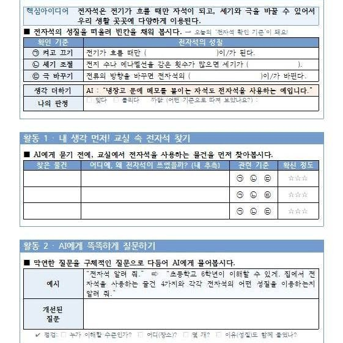
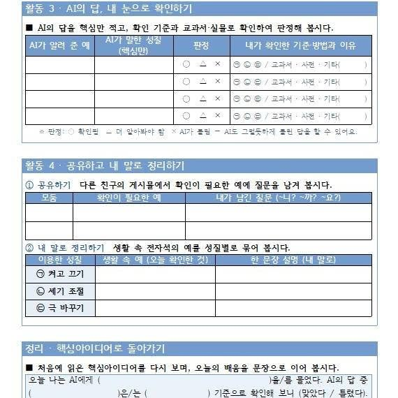

과학시간 아이들은 수업 중에도 조사의 목적으로 허용된 시간에 '우리아이 AI'에 묻는다. 그런데 교과서와 학습지는 여전히 AI가 없는 교실 수업을 전제로 만들어져 있다. 조사한 내용을 적는 칸은 AI가 몇 초 만에 채워준다. 즉, 칸은 채워졌는데 아이의 생각은 비어 있는 학습지가 현실이 되었다.

그래서 최근 수업을 위한 학생용 학습지를 만들며 생각을 지키는 장치를 일부러 넣어 보았다.

<figure>

<figcaption>학습지 앞면. 확인 기준, 내 생각 먼저, 질문 다듬기 칸.</figcaption>
</figure>

## 생각을 지키는 다섯 가지 장치

① 내 생각 먼저: AI에게 묻기 전에 내 추측과 확신 정도부터 적기

② 질문 다듬기: "알려 줘"를 대상, 범위, 이유가 담긴 구체적인 질문으로 바꾸기

③ 기준으로 확인: 배운 개념을 잣대로 AI의 답을 판정하기

④ 수용 판단: AI의 피드백을 수용, 부분 수용, 미수용 중 고르고 까닭 쓰기

⑤ 내 말로 정리하기: 베끼지 않고 다시 쓰고, AI와 함께한 과정 돌아보기

<figure>

<figcaption>학습지 뒷면. AI의 답을 기준으로 확인하고 내 말로 정리하는 칸.</figcaption>
</figure>

## 학습지 한 칸 한 칸에 스며드는 AI 리터러시

직접 실천해 볼수록 AI 리터러시는 따로 떼어 가르치는 단원이 아니라, 매 차시 학습지 한 칸 한 칸에 기본적으로 스며들어야 하는 사고의 안전장치라는 생각이 든다. AI가 답을 주는 시대일수록 학습지는 정답을 옮겨 적는 종이가 아니라 판단의 과정을 남기는 메타인지의 흔적이 되어야 하겠다.
