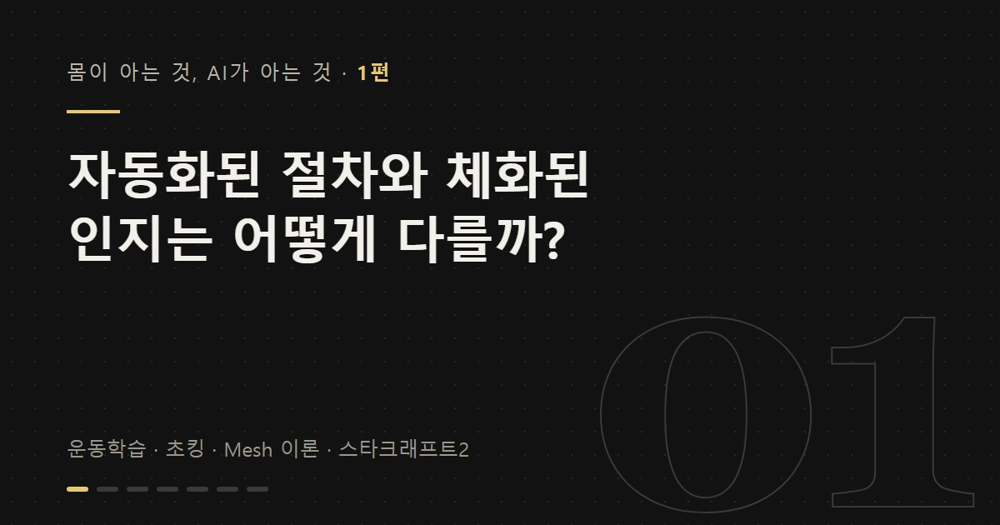

**몸이 아는 것, AI가 아는 것 시리즈** · **1 자동화와 체화** · [2 손글씨와 타이핑](/post/body-and-ai-02-handwriting-vs-typing/) · [3 도구와 오프로딩](/post/body-and-ai-03-tools-and-offloading/) · [4 추상 개념](/post/body-and-ai-04-abstract-concepts/) · [5 기호 접지](/post/body-and-ai-05-symbol-grounding/) · [6 AI 내부 들여다보기](/post/body-and-ai-06-inside-the-model/) · [7 AI와 정의](/post/body-and-ai-07-teaching-justice/)

자전거를 타면서 페달을 어떻게 밟는지 생각하는 사람은 없다. 눈을 감고도 자판을 치고, 프로게이머는 0.1초 만에 스킬을 쓸지 말지 결정한다. 우리는 이런 장면을 모두 "몸이 알아서 한다"고 말한다. 그런데 몸이 알아서 하는 일이 모두 같은 종류일까?

이 시리즈는 그 질문에서 출발한다. 몸에 익은 기술과 몸으로 하는 생각은 어떻게 다른지, 도구와 AI는 그 사이 어디에 있는지, 그리고 몸이 없는 AI는 무엇을 알 수 있는지를 연구 논문으로 하나씩 짚어 본다.

<figure>
  
  <figcaption>시리즈 1편. 자동화된 절차와 체화된 인지</figcaption>
</figure>

## 시리즈 안내

| 편 | 질문 | 주요 연구 |
|---|---|---|
| 1 | 자동화된 절차와 체화된 인지는 어떻게 다를까? | Fitts & Posner, Beilock & Carr, Mesh 이론, 스타크래프트2 빅데이터 |
| 2 | 손글씨와 타이핑, 뇌는 정말 다르게 일할까? | 손글씨 EEG 연구, 노트 필기 재현 연구 |
| 3 | 도구를 쓰는 것은 게으름일까 영리함일까? | 확장된 마음, 도구와 신체 도식, 생성형 AI와 인지 오프로딩 |
| 4 | 사랑과 정의 같은 추상 개념은 어떻게 배우는 걸까? | 원형 이론, 구성된 정서 이론, 추상 개념의 접지 |
| 5 | 몸이 없는 AI도 의미를 이해할 수 있을까? | 중국어 방, 기호 접지 문제, 문어 테스트, LLM 개념 표상 비교 |
| 6 | AI의 속을 열어 보면 이해의 흔적이 보일까? | 그로킹, 해석 가능성 연구, 페르소나 벡터, 기능적 정서 |
| 7 | 보상과 벌만으로 AI에게 정의를 가르칠 수 있을까? | ETHICS 데이터셋, 명세 게이밍, 보상 변조, 도덕 역량 평가 |

## 먼저 두 개념의 층위가 다르다

두 개념을 같은 저울에 올리면 토론이 꼬이기 쉽다. 둘은 애초에 서로 다른 질문에 대한 답이기 때문이다.

- **자동화된 절차**는 기술이 어떤 **상태**에 도달했는지를 말한다. 충분히 반복된 절차는 의식적인 통제 없이도 빠르고 정확하게 실행된다. 심리학에서는 흔히 절차 기억, 자동성이라는 말로 다룬다.
- **체화된 인지**는 생각이 **어디서 어떻게** 일어나는지에 대한 관점이다. 생각은 머릿속 계산만이 아니라 몸의 감각, 움직임, 환경과의 상호작용에 걸쳐 일어난다고 본다.

그래서 "손글씨는 자동화인가 체화인가?"라는 질문은 "이 사과는 빨간가 달콤한가?"와 비슷한 면이 있다. 둘 다일 수 있다. 더 쓸모 있는 질문은 "어떤 기준으로 구분할 수 있는가?"이다. 아래 네 연구가 그 기준을 하나씩 준다.

## 연구 1. 기술은 세 단계를 거쳐 자동이 된다

*Fitts, P. M., & Posner, M. I. (1967). Human Performance* (단행본)

운동학습 분야에서 가장 널리 알려진 모델이다. 기술을 배우는 과정을 세 단계로 나눈다.

| 단계 | 학습자의 머릿속 | 예시 |
|---|---|---|
| 인지 단계 | 무엇을 해야 하는지 하나하나 생각한다 | 처음 보는 외국 문자를 획순을 보며 따라 쓴다 |
| 연합 단계 | 무엇을 할지가 어떻게 할지로 바뀐다 | 자판 위치를 대략 외웠지만 가끔 내려다본다 |
| 자동화 단계 | 거의 생각하지 않아도 된다 | 눈을 감고 타이핑하면서 다른 생각을 한다 |

책은 마지막 단계에서 구성 과정이 점점 자율적이 되고, 인지적 통제를 덜 받으며, 다른 활동이나 주변의 방해에도 덜 흔들린다고 설명한다. 걷기처럼 잘 익힌 기술은 말하기를 방해하지 않는다는 예도 든다.

**쉽게 말하면** 낯선 문자를 따라 쓰며 원리를 익히는 것과 눈 감고 치는 타이핑은 종류가 다르다기보다 같은 길의 다른 지점에 있을 수 있다. 처음에는 머리로 하던 일이 반복을 거치며 몸으로 내려간다.

## 연구 2. 의식이 끼어들면 무너지는 기술이 있다

*Beilock, S. L., & Carr, T. H. (2001). On the fragility of skilled performance. Journal of Experimental Psychology: General, 130(4), 701-725.*

중요한 순간에 프로 선수가 어이없는 실수를 하는 현상을 초킹(choking)이라고 한다. 이 연구는 골프 퍼팅으로 그 원인을 파고들었다.

- 숙련된 골퍼는 퍼팅의 일반적인 요령은 잘 설명했지만, 방금 한 특정 퍼팅을 어떻게 했는지는 잘 기억하지 못했다. 연구진은 숙련된 퍼팅이 단계별 주의 없이 돌아가는 절차적 형태로 저장되어 있다고 해석했다.
- 압박을 주자 퍼팅에서는 초킹이 일어났다. 반면 아직 절차화되지 않은 '알파벳 산수' 과제에서는 일어나지 않았다.
- 퍼팅의 초킹은 두 가지 일을 동시에 하는 훈련으로는 줄지 않았고, 남이 지켜보는 상황에 익숙해지는 훈련으로는 사라졌다.

**쉽게 말하면** 자동화된 기술은 "지금 내 손목이 어떻게 움직이지?" 하고 의식하는 순간 오히려 망가질 수 있다. 이것은 어떤 기술이 자동화되었는지 확인하는 실용적인 시험지가 된다. 의식적으로 주의를 기울일 때 수행이 무너지면 자동화 쪽에 가깝고, 주의를 기울일수록 정교해지면 상황을 읽는 판단이 살아 있는 쪽에 가깝다.

## 연구 3. 고수의 행동에는 자동과 통제가 함께 있다

*Christensen, W., Sutton, J., & McIlwain, D. J. F. (2016). Cognition in skilled action: Meshed control and the varieties of skill experience. Mind & Language, 31(1), 37-66.*

전통적인 관점은 "고수일수록 자동으로 하고, 생각이 끼어들면 방해만 된다"였다. 이 논문은 여기에 반대하며 Mesh(맞물림) 이론을 내놓았다.

핵심 주장은 이렇다. 기술을 배우는 동안 인지적 통제는 줄어들고 자동 통제의 비중이 커지지만, 높은 수준에 이른 뒤에도 인지적 통제는 계속 실질적인 기여를 한다. 자동 과정은 세밀한 동작을 맡고, 인지 과정은 상황에 맞게 행동을 조정하거나 문제를 해결한다. 둘은 톱니바퀴처럼 맞물려 돌아간다.

Toner와 Moran이 2020년 Review of Philosophy and Psychology에 발표한 후속 논의는 한 걸음 더 나아가, 통제 과정과 자동 과정이 시소처럼 한쪽이 오르면 다른 쪽이 내려가는 관계가 아니라 **동시에 병렬로** 작동해야 숙련 행동이 가능하다고 주장한다.

**쉽게 말하면** 프로게이머가 캐릭터를 움직이는 손놀림은 자동화되어 있지만, 지금 스킬을 써서 얻는 이득과 잃는 기회를 따지는 판단은 매 순간 살아 있다. 한 행위 안에 두 가지가 공존한다는 직관은 학계에서도 진지하게 다뤄지는 이론이다.

## 연구 4. 실력이 오를수록 실력을 만드는 요소가 바뀐다

*Thompson, J. J., Blair, M. R., Chen, L., & Henrey, A. J. (2013). Video game telemetry as a critical tool in the study of complex skill learning. PLoS ONE, 8(9), e75129.*

숙련 연구는 보통 전문가와 초보자 두 집단을 비교한다. 이 연구는 실시간 전략 게임 스타크래프트2의 리플레이 파일을 모아, 브론즈부터 그랜드마스터와 프로까지 일곱 단계 실력에 걸친 3,360명의 플레이를 분석했다. 인지-운동, 주의, 지각 처리를 반영하는 지표를 뽑아내고 그중 전문성과 관련된 12개 변인을 찾았다.

가장 중요한 발견은 **어떤 변인이 실력을 잘 예측하는지가 실력 단계마다 달라진다**는 것이다. 연구진은 전문가와 초보자만 비교했다면 오해를 낳았을 것이라고 지적한다. 화면을 보고 행동에 옮기기까지 걸리는 시간 같은 지각-행동 지표, 단축키를 지정해 클릭 부담을 게임 인터페이스에 넘기는 습관 같은 지표가 함께 분석되었다.

**쉽게 말하면** "프로게이머의 피지컬"은 하나의 능력이 아니다. 낮은 단계에서 실력을 가르는 요소와 높은 단계에서 실력을 가르는 요소가 다르다. 단축키 사용처럼 일부 조작을 도구에 넘기는 전략이 실력의 일부라는 점도 흥미롭다. 이 이야기는 3편의 도구 이야기로 이어진다.

## 정리. 두 개념을 가르는 세 가지 질문

| 질문 | 자동화된 절차에 가까우면 | 체화된 판단에 가까우면 |
|---|---|---|
| 학습의 어느 단계인가? | 자동화 단계. 생각하지 않아도 된다 | 인지·연합 단계이거나, 숙련 후에도 상황 판단이 필요하다 |
| 의식적으로 주의를 기울이면? | 오히려 수행이 흔들릴 수 있다 | 수행이 더 정교해질 수 있다 |
| 낯선 상황을 만나면? | 익숙한 패턴을 그대로 반복한다 | 몸의 감각을 바탕으로 행동을 조정한다 |

결국 실제 행동은 대부분 두 가지가 섞여 있다. 그래서 "이 행동은 자동화인가 체화인가?"보다 "이 행동의 어느 부분이 자동화되어 있고 어느 부분에서 판단이 일어나는가?"라고 묻는 편이 더 많은 것을 보여 준다.

## 더 생각해 볼 질문

1. 의식하는 순간 망가지는 나의 기술과, 의식할수록 좋아지는 나의 기술을 하나씩 떠올려 보자. 둘은 무엇이 다른가?
2. 체스 고수가 수천 가지 국면을 훈련으로 익혀 한눈에 좋은 수를 보는 것은 자동화일까, 체화된 판단일까?
3. 기술이 완전히 자동화되면 그 기술에 대해 생각하는 능력은 사라지는 걸까?

다음 편에서는 가장 일상적인 사례인 손글씨와 타이핑을 뇌파 연구로 들여다본다.

## 참고 자료

- Fitts, P. M., & Posner, M. I. (1967). *Human Performance*. Brooks/Cole. [인터넷 아카이브](https://archive.org/details/in.ernet.dli.2015.461945)
- Beilock, S. L., & Carr, T. H. (2001). On the fragility of skilled performance: What governs choking under pressure? *Journal of Experimental Psychology: General, 130*(4), 701-725. [doi.org/10.1037/0096-3445.130.4.701](https://doi.org/10.1037/0096-3445.130.4.701)
- Christensen, W., Sutton, J., & McIlwain, D. J. F. (2016). Cognition in skilled action: Meshed control and the varieties of skill experience. *Mind & Language, 31*(1), 37-66. [doi.org/10.1111/mila.12094](https://doi.org/10.1111/mila.12094)
- Toner, J., & Moran, A. (2021). Exploring the orthogonal relationship between controlled and automated processes in skilled action. *Review of Philosophy and Psychology, 12*(3), 577-593. [doi.org/10.1007/s13164-020-00505-6](https://doi.org/10.1007/s13164-020-00505-6)
- Thompson, J. J., Blair, M. R., Chen, L., & Henrey, A. J. (2013). Video game telemetry as a critical tool in the study of complex skill learning. *PLoS ONE, 8*(9), e75129. [doi.org/10.1371/journal.pone.0075129](https://doi.org/10.1371/journal.pone.0075129)
- 함께 읽기: [학습과학 아틀라스 7, 체화된, 상황적, 확장된 인지](/post/learning-science-atlas-07-embodied-cognition/)
