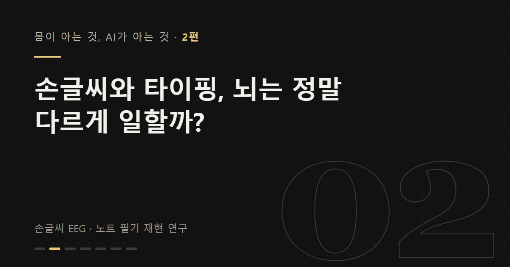

**몸이 아는 것, AI가 아는 것 시리즈** · [1 자동화와 체화](/post/body-and-ai-01-automatic-vs-embodied/) · **2 손글씨와 타이핑** · [3 도구와 오프로딩](/post/body-and-ai-03-tools-and-offloading/) · [4 추상 개념](/post/body-and-ai-04-abstract-concepts/) · [5 기호 접지](/post/body-and-ai-05-symbol-grounding/) · [6 AI 내부 들여다보기](/post/body-and-ai-06-inside-the-model/) · [7 AI와 정의](/post/body-and-ai-07-teaching-justice/)

익숙해지고 나면 손글씨와 타이핑은 둘 다 생각을 그대로 옮겨 적는 출력 장치처럼 느껴진다. 그렇다면 둘 다 똑같이 자동화된 절차일 뿐일까? 이 질문에는 두 갈래의 연구가 답한다. 하나는 쓰는 동안 뇌에서 무슨 일이 일어나는지를 본 뇌파 연구이고, 다른 하나는 무엇으로 필기해야 더 잘 배우는지를 본 행동 연구다. 두 갈래의 결론은 생각보다 엇갈린다.

<figure>
  
  <figcaption>시리즈 2편. 손글씨와 타이핑</figcaption>
</figure>

## 왜 손글씨와 타이핑은 다를 수 있을까?

움직임의 구조부터 다르다. 손으로 'ㄱ'과 'ㅎ'을 쓸 때는 글자마다 전혀 다른 손의 궤적이 필요하다. 글자의 모양이 곧 움직임의 모양이다. 반면 자판에서는 어떤 글자든 손가락으로 키 하나를 누르는 같은 동작이다. 글자의 모양과 손의 움직임 사이에 연결이 없다.

체화된 인지의 관점에서 보면 이 차이는 작지 않다. 글자를 알아보는 능력에 그 글자를 만들어 낸 몸의 움직임이 함께 저장될 수 있기 때문이다.

## 연구 1. 손으로 배운 글자를 더 잘 알아본다

*Longcamp, M., Zerbato-Poudou, M.-T., & Velay, J.-L. (2005). Acta Psychologica, 119(1), 67-79.*

3~5세 유아 76명을 두 집단으로 나눠 3주 동안 알파벳을 손으로 베껴 쓰거나 자판으로 치며 익히게 한 뒤, 글자 인식 검사를 두 번 치렀다. 나이가 많은 아이들에게서는 손으로 쓰며 배운 집단이 자판으로 배운 집단보다 글자를 더 잘 알아보았다. 연구진은 손글씨의 움직임이 글자의 모양을 온전히 정의하기 때문에 글자의 내적 모형을 만드는 데 도움이 된다고 해석했다.

비슷한 방향의 뇌 영상 연구도 있다. James와 Engelhardt(2012)는 글을 아직 읽지 못하는 5세 아이들에게 글자를 손으로 쓰게 하거나, 치게 하거나, 따라 그리게 한 뒤 fMRI로 관찰했다. 글자를 볼 때 읽기와 관련된 뇌 회로가 활성화된 것은 손으로 쓴 경험이 있을 때뿐이었다.

다만 여기에도 단서가 붙는다. Longcamp 등의 연구에서 효과는 나이 많은 아이들에게만 나타났고, 독일의 후속 연구(Kiefer 등, 2015)에서는 손글씨 훈련이 타이핑 훈련보다 글자 인식을 더 높이지 않았다. 이 연구의 아이들은 훈련 전부터 글자를 꽤 알고 있었고, 표본도 작았다.

**쉽게 말하면** 글자를 '보는' 능력이 글자를 '만드는' 몸의 경험과 묶여 있을 수 있다는 증거가 있다. 다만 그 효과가 언제, 누구에게 나타나는지는 아직 연구마다 다르다.

## 연구 2. 손으로 쓸 때와 칠 때 뇌파가 다르다

*Ose Askvik, E., van der Weel, F. R., & van der Meer, A. L. H. (2020). Frontiers in Psychology, 11, 1810.*

노르웨이 연구진은 256개 전극으로 뇌파를 정밀하게 측정하는 고밀도 EEG로 대학생 12명과 12세 아동 12명을 관찰했다. 화면에 나온 단어를 디지털 펜으로 필기체로 쓰거나, 자판으로 치거나, 그림으로 그리게 했다.

- 대학생이 손으로 쓸 때 두정엽과 중심 영역에서 세타파 대역의 동기화된 활동이 나타났다. 기존 연구에서 이런 활동은 기억과 새로운 정보의 부호화에 중요한 것으로 알려져 있다.
- 자판으로 칠 때는 같은 영역에서 다른 양상(비동기화)이 나타났다. 연구진은 이것이 학습과 어떤 관계인지는 분명하지 않다고 밝혔다.

## 연구 3. 손글씨는 뇌를 더 넓게 연결한다

*Van der Weel, F. R., & Van der Meer, A. L. H. (2024). Frontiers in Psychology, 14, 1219945.*

같은 연구진이 대학생 36명의 뇌파를 이번에는 영역 사이의 **연결성** 관점에서 분석했다. 뇌의 여러 영역이 얼마나 함께 리듬을 맞추는지를 본 것이다.

결과는 제목 그대로다. 손으로 쓸 때는 두정엽과 중심 영역 사이에서 세타·알파 대역의 연결이 넓게 나타났고, 유의미한 연결이 16개 확인되었다. 타이핑에서는 이런 연결이 나타나지 않았다.

**쉽게 말하면** 숙련된 대학생에게도 손글씨는 뇌의 감각, 운동, 기억 관련 영역을 함께 끌어들이는 일이고, 타이핑은 그렇지 않았다. 둘 다 자동화되어 있더라도 그 안에서 일어나는 처리는 다를 수 있다는 뜻이다.

## 연구 4. 손필기가 더 잘 배운다는 유명한 연구

*Mueller, P. A., & Oppenheimer, D. M. (2014). The pen is mightier than the keyboard. Psychological Science, 25(6), 1159-1168.*

손필기 논쟁을 대중에게 알린 연구다. 대학생들이 강의를 들으며 노트북이나 손으로 필기한 뒤 시험을 보았다. 노트북으로 필기한 학생들은 강의 내용을 받아쓰듯 그대로 옮겨 적는 경향이 강했고, 개념을 묻는 문제에서 손으로 필기한 학생들보다 낮은 점수를 받았다.

연구진의 설명은 이렇다. 손은 느리기 때문에 다 받아 적을 수 없다. 그래서 들은 내용을 자기 말로 요약하고 골라 적게 되고, 이 과정이 더 깊은 처리를 만든다.

## 연구 5. 그런데 재현해 보니 차이가 흐려졌다

*Morehead, K., Dunlosky, J., & Rawson, K. A. (2019). Educational Psychology Review, 31(3), 753-780.*
*Urry, H. L., et al. (2021). Psychological Science, 32(3), 326-339.*

두 연구팀이 Mueller와 Oppenheimer의 실험을 그대로 다시 해 보았다.

- Morehead 등은 손필기가 낫다는 경향은 일부 보였지만, 집단 사이의 성적 차이는 일관되지 않았다. 필기를 아예 하지 않은 집단과도 확실한 차이가 없었다. 여러 재현 연구를 묶은 메타분석에서도 손필기 쪽의 효과는 작고 통계적으로 유의하지 않았다. 연구진은 어느 방법이 더 낫다고 결론 내리기는 이르다고 정리했다.
- Urry 등의 재현에서도 노트북 필기가 더 많은 단어를, 더 받아쓰듯 적는다는 점은 원래 연구와 같았다. 하지만 퀴즈 성적에는 차이가 없었다. 비슷한 연구 8편을 묶은 분석도 같은 방향이었다. 연구진은 손필기가 부호화를 개선해 즉각적인 학습을 높인다는 주장을 결과가 지지하지 않는다고 결론지었다.

## 정리. 뇌가 다르게 일한다는 것과 더 잘 배운다는 것

| 질문 | 현재 증거 |
|---|---|
| 손글씨와 타이핑은 뇌에서 다르게 처리되는가? | 그렇다는 뇌파 증거가 꾸준히 쌓이고 있다 |
| 손으로 글자를 익히면 글자를 더 잘 알아보는가? | 그렇다는 유아 연구가 있지만, 재현되지 않은 연구도 있다 |
| 강의 필기를 손으로 하면 시험을 더 잘 보는가? | 재현 연구에서 뚜렷한 차이가 확인되지 않았다 |

여기서 배울 점은 두 가지다.

첫째, **뇌 활동의 차이가 곧 학습 효과의 차이는 아니다.** 뇌가 더 넓게 연결된다는 것은 흥미로운 사실이지만, 그것이 시험 점수나 장기 기억으로 이어지는지는 따로 확인해야 하는 문제다.

둘째, **도구보다 처리 방식이 중요할 수 있다.** 노트북으로도 자기 말로 요약하며 적으면 깊은 처리가 일어나고, 손으로도 받아쓰기만 하면 얕은 처리에 머문다. 손글씨의 장점이 몸의 움직임 자체에서 오는지, 느림이 강제하는 요약에서 오는지는 아직 완전히 갈라지지 않은 질문이다.

## 더 생각해 볼 질문

1. 글자를 처음 배우는 아이와 이미 숙련된 고등학생에게 손글씨의 의미는 같을까?
2. 손글씨의 장점이 '느림'에서 온다면, 타이핑을 일부러 느리게 만드는 방법으로도 같은 효과를 낼 수 있을까?
3. 태블릿에 디지털 펜으로 쓰는 것은 손글씨일까, 타이핑일까?

다음 편에서는 펜과 자판을 넘어 도구 일반, 그리고 생성형 AI로 질문을 넓힌다. 도구에 일을 맡기는 것은 게으름일까 영리함일까?

## 참고 자료

- Longcamp, M., Zerbato-Poudou, M.-T., & Velay, J.-L. (2005). The influence of writing practice on letter recognition in preschool children: A comparison between handwriting and typing. *Acta Psychologica, 119*(1), 67-79. [doi.org/10.1016/j.actpsy.2004.10.019](https://doi.org/10.1016/j.actpsy.2004.10.019)
- James, K. H., & Engelhardt, L. (2012). The effects of handwriting experience on functional brain development in pre-literate children. *Trends in Neuroscience and Education, 1*(1), 32-42. [doi.org/10.1016/j.tine.2012.08.001](https://doi.org/10.1016/j.tine.2012.08.001)
- Kiefer, M., Schuler, S., Mayer, C., Trumpp, N. M., Hille, K., & Sachse, S. (2015). Handwriting or typewriting? The influence of pen- or keyboard-based writing training on reading and writing performance in preschool children. *Advances in Cognitive Psychology, 11*(4), 136-146. [doi.org/10.5709/acp-0178-7](https://doi.org/10.5709/acp-0178-7)
- Ose Askvik, E., van der Weel, F. R., & van der Meer, A. L. H. (2020). The importance of cursive handwriting over typewriting for learning in the classroom: A high-density EEG study of 12-year-old children and young adults. *Frontiers in Psychology, 11*, 1810. [doi.org/10.3389/fpsyg.2020.01810](https://doi.org/10.3389/fpsyg.2020.01810)
- Van der Weel, F. R., & Van der Meer, A. L. H. (2024). Handwriting but not typewriting leads to widespread brain connectivity: A high-density EEG study with implications for the classroom. *Frontiers in Psychology, 14*, 1219945. [doi.org/10.3389/fpsyg.2023.1219945](https://doi.org/10.3389/fpsyg.2023.1219945)
- Mueller, P. A., & Oppenheimer, D. M. (2014). The pen is mightier than the keyboard: Advantages of longhand over laptop note taking. *Psychological Science, 25*(6), 1159-1168. [doi.org/10.1177/0956797614524581](https://doi.org/10.1177/0956797614524581)
- Morehead, K., Dunlosky, J., & Rawson, K. A. (2019). How much mightier is the pen than the keyboard for note-taking? A replication and extension of Mueller and Oppenheimer (2014). *Educational Psychology Review, 31*(3), 753-780. [doi.org/10.1007/s10648-019-09468-2](https://doi.org/10.1007/s10648-019-09468-2)
- Urry, H. L., et al. (2021). Don't ditch the laptop just yet: A direct replication of Mueller and Oppenheimer's (2014) Study 1 plus mini meta-analyses across similar studies. *Psychological Science, 32*(3), 326-339. [doi.org/10.1177/0956797620965541](https://doi.org/10.1177/0956797620965541)
