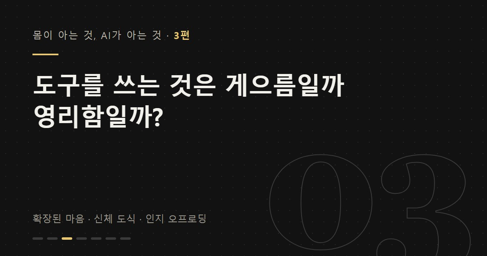

**몸이 아는 것, AI가 아는 것 시리즈** · [1 자동화와 체화](/post/body-and-ai-01-automatic-vs-embodied/) · [2 손글씨와 타이핑](/post/body-and-ai-02-handwriting-vs-typing/) · **3 도구와 오프로딩** · [4 추상 개념](/post/body-and-ai-04-abstract-concepts/) · [5 기호 접지](/post/body-and-ai-05-symbol-grounding/) · [6 AI 내부 들여다보기](/post/body-and-ai-06-inside-the-model/) · [7 AI와 정의](/post/body-and-ai-07-teaching-justice/)

"게으른 사람이 도구를 만든다"는 말이 있다. 계산기, 메모, 내비게이션, 그리고 생성형 AI까지, 사람은 늘 머리와 몸이 하던 일을 바깥으로 넘겨 왔다. 이것은 게으름일까 영리함일까? 연구들은 이 질문을 "무엇을 넘겼고, 넘긴 뒤에 내 안에 무엇이 남는가"로 바꾸어 묻는다.

<figure>
  
  <figcaption>시리즈 3편. 도구와 인지 오프로딩</figcaption>
</figure>

## 연구 1. 마음은 머리 밖으로 확장될 수 있다

*Clark, A., & Chalmers, D. (1998). The extended mind. Analysis, 58(1), 7-19.*

철학자 Clark와 Chalmers는 도발적인 사고 실험을 내놓았다. 기억력이 좋은 잉가는 미술관 주소를 머릿속에서 떠올린다. 기억에 문제가 있는 오토는 늘 들고 다니는 수첩에서 주소를 찾는다. 두 사람 모두 같은 믿음을 바탕으로 같은 행동을 한다. 그렇다면 오토의 수첩은 잉가의 뇌 속 기억과 같은 역할을 하는 셈이고, 오토의 마음의 일부라고 볼 수 있지 않을까?

이 확장된 마음 가설은 인지 시스템을 뇌와 신경계만으로 설명할 수 없고, 몸과 환경 속 도구까지 포함해야 한다고 본다.

**쉽게 말하면** 도구를 쓰는 것이 생각을 '안 하는' 것이 아니라, 생각이 도구까지 걸쳐서 '일어나는' 것일 수 있다는 관점이다.

## 연구 2. 도구는 몸의 지도에 들어온다

*Maravita, A., & Iriki, A. (2004). Tools for the body (schema). Trends in Cognitive Sciences, 8(2), 79-86.*

뇌에는 내 몸의 모양과 자세를 실시간으로 그리는 지도, 곧 신체 도식(body schema)이 있다. 이 리뷰는 원숭이의 단일 뉴런 기록과 사람의 행동 실험, 뇌 손상 환자 연구를 모아, 도구를 써서 먼 물건에 손을 뻗을 때 이 지도가 바뀐다는 증거를 정리했다. 마치 손이 도구 끝까지 늘어난 것처럼 처리된다는 것이다.

물론 반론도 있다. Bell과 Macuga(2022)는 도구가 정말 신체 표상의 일부로 편입되는지에 대한 증거를 다시 점검하는 리뷰를 냈다. 도구의 체화는 여전히 논쟁 중인 주제다.

**쉽게 말하면** 숙련된 테니스 선수에게 라켓은 손에 든 물건이라기보다 팔의 연장에 가깝다. 이런 수준의 도구는 몸의 일부가 된다.

## 연구 3. 인지 오프로딩, 생각의 짐을 바깥에 내려놓기

*Risko, E. F., & Gilbert, S. J. (2016). Cognitive offloading. Trends in Cognitive Sciences, 20(9), 676-688.*

인지 오프로딩은 몸을 움직이거나 바깥 도구를 써서 머릿속 처리 부담을 줄이는 모든 행동을 말한다. 고개를 기울여 기울어진 글씨를 읽는 것, 손가락으로 세는 것, 알림을 맞춰 두는 것이 모두 여기에 들어간다.

이 리뷰가 강조하는 점은 오프로딩이 무조건 나쁘지도, 무조건 좋지도 않다는 것이다. 사람은 내 기억력과 능력에 대한 믿음, 곧 메타인지적 판단에 따라 넘길지 말지를 정한다. 그리고 그 판단이 늘 정확하지는 않다.

## 연구 4. 생성형 AI 시대의 오프로딩

생성형 AI는 기억이나 계산만이 아니라 추론과 글쓰기까지 넘겨받을 수 있다는 점에서 이전 도구와 다르다. 최근 연구들을 증거의 강도와 함께 살펴보자.

### AI를 많이 쓸수록 비판적 사고 점수가 낮았다

*Gerlich, M. (2025). AI tools in society: Impacts on cognitive offloading and the future of critical thinking. Societies, 15(1), 6.*

영국의 666명을 설문하고 50명을 심층 면담했다. AI 도구를 자주 쓸수록 비판적 사고 점수가 낮았고(상관계수 약 -0.68), 이 관계를 인지 오프로딩이 일부 설명했다. 17~25세 젊은 층이 AI 의존도가 가장 높고 비판적 사고 점수가 낮았으며, 학력이 높을수록 AI 사용과 무관하게 비판적 사고 점수가 높았다.

**주의할 점** 한 시점의 설문으로 본 상관관계다. AI가 비판적 사고를 떨어뜨렸는지, 원래 비판적으로 덜 따지는 사람이 AI를 더 쓰는지는 이 설계로 구분할 수 없다. 비판적 사고 측정에도 자기 보고가 섞여 있다.

### AI로 글을 쓸 때 뇌의 연결이 약했다

*Kosmyna, N., et al. (2025). Your brain on ChatGPT. arXiv:2506.08872.*

MIT 미디어랩 연구진은 참여자들이 에세이를 쓰는 동안 뇌파를 측정했다. ChatGPT를 쓴 집단은 검색엔진을 쓴 집단이나 도구 없이 쓴 집단보다 뇌의 기능적 연결이 약했다. 연구진은 이를 '인지 부채(cognitive debt)'라고 불렀다.

**주의할 점** 동료 심사를 거치지 않은 프리프린트이고, 처음 참여자는 54명, 조건을 바꿔 다시 쓴 세션까지 마친 사람은 18명이었다. 흥미로운 예비 증거로 읽어야 한다.

### 결과는 한 방향이 아니다

*Cong-Lem, N., & Thuy-Dung, N. T. (2026). European Journal of Psychology of Education, 41(2), 41.*

생성형 AI와 비판적 사고 연구를 모은 범위 검토는 결과가 양쪽으로 갈린다고 정리했다. 연구의 72.4%에서 AI는 정보 찾기나 초안 쓰기 같은 낮은 수준의 부담을 덜어 주어 더 높은 수준의 추론에 집중하게 하는 비계 역할을 했다. 하지만 아무 제약 없이 매끄럽게 쓰는 경우 피상적으로 참여하고 인지적 노력을 덜 들이는 경로도 확인되었다. AI가 비판적 사고를 키우는 경우는 검증하고, 근거를 대고, 스스로 조절하며 쓰도록 수업이 설계되었을 때였다.

### 도구를 뺐을 때 무엇이 남는가

*Chen, X. (2026). Layer-sensitive cognitive offloading in generative AI-assisted writing. Frontiers in Psychology, 17, 1906199.*

이 연구는 질문을 가장 날카롭게 만든다. 중국 대학생 168명이 8주 동안 영어 학술 글쓰기를 세 조건으로 했다. AI 없이 쓰기, 범위를 정한 AI 지원과 의무적인 성찰, 자유로운 AI 협업이다. 마지막 주에는 모두 AI 없이 새 과제를 썼다.

- AI의 도움을 받는 동안에는 자유 협업 집단의 글이 가장 좋았다.
- AI 없이 혼자 쓴 마지막 과제에서는 범위를 정하고 성찰한 집단이 유리한 패턴을 보였다.
- 자유 협업 집단은 문장 다듬기 같은 표면적 도움보다 아이디어와 추론 자체를 AI에 넘기는 비율이 훨씬 크게 늘었다.

**주의할 점** 여섯 개 학급 단위로 비교한 준실험이라 통계적 불확실성이 크다고 연구자 스스로 밝혔다. 그래도 "AI와 함께 낸 결과물"과 "AI를 뺀 뒤 남은 능력"을 따로 재야 한다는 설계 자체가 중요한 시사점이다.

## 정리. 게으름과 영리함을 가르는 것

| 질문 | 영리한 오프로딩 | 위험한 오프로딩 |
|---|---|---|
| 무엇을 넘겼나? | 기억, 계산, 표면적 다듬기처럼 핵심이 아닌 부담 | 아이디어와 추론처럼 배워야 할 핵심 |
| 넘긴 뒤 무엇을 하나? | 아낀 힘을 더 높은 수준의 사고에 쓴다 | 결과물을 그대로 받아들인다 |
| 도구를 빼면? | 능력이 남아 있다 | 능력이 함께 사라진다 |

게으름은 도구를 만든 동력이었을지 모른다. 그런데 도구가 생각의 핵심까지 넘겨받을 수 있게 된 지금, 같은 게으름이 영리함이 될지 위축이 될지는 무엇을 넘기느냐에 달려 있다. 1편에서 본 프로게이머의 단축키처럼, 조작은 도구에 넘기고 판단은 내가 쥐는 방식이 하나의 답이 될 수 있다.

생성형 AI에 생각을 맡기는 문제, 곧 맡긴 지식을 내 것으로 착각하는 이유와 맡긴 생각을 다시 내 것으로 회수하는 방법은 [생각을 맡긴다는 것 시리즈](/post/outsourcing-mind-01-offloading-tradeoffs/) 6편에서 더 깊이 다뤘다.

## 더 생각해 볼 질문

1. 내가 매일 쓰는 도구 중 몸의 일부처럼 느껴지는 것과 아직 '물건'으로 느껴지는 것은 무엇이 다를까?
2. 오토의 수첩이 마음의 일부라면, 내 휴대폰 속 AI 비서도 내 마음의 일부일까? 어떤 조건이 필요할까?
3. 이번 주에 AI에 넘긴 일 가운데, 다시 혼자 해야 한다면 할 수 있는 일과 할 수 없는 일을 나누어 보자.

다음 편에서는 손에 잡히지 않는 것, 사랑이나 정의 같은 추상 개념을 우리가 어떻게 배우는지 살펴본다.

## 참고 자료

- Clark, A., & Chalmers, D. (1998). The extended mind. *Analysis, 58*(1), 7-19. [doi.org/10.1093/analys/58.1.7](https://doi.org/10.1093/analys/58.1.7)
- Maravita, A., & Iriki, A. (2004). Tools for the body (schema). *Trends in Cognitive Sciences, 8*(2), 79-86. [doi.org/10.1016/j.tics.2003.12.008](https://doi.org/10.1016/j.tics.2003.12.008)
- Bell, J. D., & Macuga, K. L. (2022). Are tools truly incorporated as an extension of the body representation? Assessing the evidence for tool embodiment. *Psychonomic Bulletin & Review, 29*(2), 343-368. [doi.org/10.3758/s13423-021-02032-6](https://doi.org/10.3758/s13423-021-02032-6)
- Risko, E. F., & Gilbert, S. J. (2016). Cognitive offloading. *Trends in Cognitive Sciences, 20*(9), 676-688. [doi.org/10.1016/j.tics.2016.07.002](https://doi.org/10.1016/j.tics.2016.07.002)
- Gerlich, M. (2025). AI tools in society: Impacts on cognitive offloading and the future of critical thinking. *Societies, 15*(1), 6. [doi.org/10.3390/soc15010006](https://doi.org/10.3390/soc15010006)
- Kosmyna, N., et al. (2025). Your brain on ChatGPT: Accumulation of cognitive debt when using an AI assistant for essay writing task. *arXiv:2506.08872*. [arxiv.org/abs/2506.08872](https://arxiv.org/abs/2506.08872)
- Cong-Lem, N., & Thuy-Dung, N. T. (2026). Towards a framework for understanding and assessing critical thinking in generative AI-enhanced learning environments: A scoping review. *European Journal of Psychology of Education, 41*(2), 41. [doi.org/10.1007/s10212-026-01089-y](https://doi.org/10.1007/s10212-026-01089-y)
- Chen, X. (2026). Layer-sensitive cognitive offloading in generative AI-assisted writing: Supported performance and independent no-AI outcomes. *Frontiers in Psychology, 17*, 1906199. [doi.org/10.3389/fpsyg.2026.1906199](https://doi.org/10.3389/fpsyg.2026.1906199)
- 함께 읽기: [AI가 과연 생각의 수고를 없애는가?](/post/does-ai-remove-cognitive-effort/) · [생각을 맡긴다는 것 시리즈 1편, 생각을 바깥에 맡기는 것은 늘 손해일까?](/post/outsourcing-mind-01-offloading-tradeoffs/) · [AI가 다 알려 주는 시대에 왜 여전히 머릿속 지식이 필요한가?](/post/oakley-2026-memory-paradox/)
