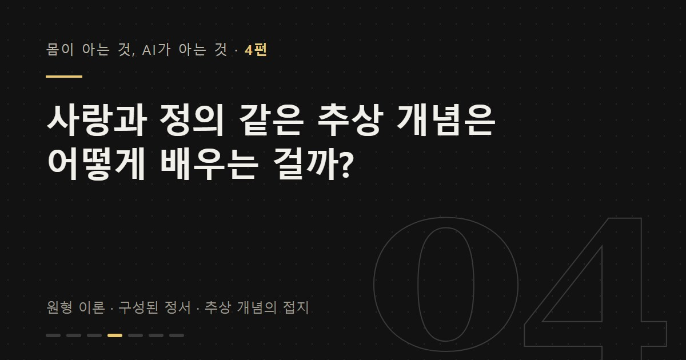

**몸이 아는 것, AI가 아는 것 시리즈** · [1 자동화와 체화](/post/body-and-ai-01-automatic-vs-embodied/) · [2 손글씨와 타이핑](/post/body-and-ai-02-handwriting-vs-typing/) · [3 도구와 오프로딩](/post/body-and-ai-03-tools-and-offloading/) · **4 추상 개념** · [5 기호 접지](/post/body-and-ai-05-symbol-grounding/) · [6 AI 내부 들여다보기](/post/body-and-ai-06-inside-the-model/) · [7 AI와 정의](/post/body-and-ai-07-teaching-justice/)

아이는 사과를 보고, 만지고, 먹어 보며 '사과'를 배운다. 그런데 '사랑'이나 '정의'는 만질 수도 먹어 볼 수도 없다. 그렇다면 우리는 이런 개념을 어떻게 배울까? 몸으로 생각한다는 체화된 인지 이론에게 추상 개념은 가장 어려운 시험대다. 이 글은 그 시험을 세 단계로 따라간다. 개념은 어떤 모양인가, 감정 개념은 어떻게 만들어지는가, 정의 같은 개념도 몸에 뿌리를 두는가.

<figure>
  
  <figcaption>시리즈 4편. 추상 개념은 어떻게 배우는가</figcaption>
</figure>

## 연구 1. 개념에는 진한 중심과 흐린 가장자리가 있다

*Rosch, E. (1975). Cognitive representations of semantic categories. Journal of Experimental Psychology: General, 104(3), 192-233.*

전통적으로 개념은 필요충분조건으로 정의된다고 여겨졌다. 날개가 있고, 깃털이 있고, 알을 낳으면 새다. 그런데 사람들에게 물어보면 참새는 '아주 새다운 새'이고 펭귄은 '좀 덜 새다운 새'다. Rosch는 대학생 663명을 대상으로 한 아홉 개의 실험에서, 범주 이름이 떠올리게 하는 표상에 이런 **내부 구조**가 있다는 것을 보였다. 범주에는 가장 대표적인 원형(prototype)이 있고, 구성원들은 원형에 얼마나 가까운지에 따라 정도의 차이를 가진다.

**쉽게 말하면** 개념은 칼로 자른 상자가 아니라 물에 떨어뜨린 잉크와 비슷하다. 모두가 동의하는 진한 중심이 있고, 바깥으로 갈수록 흐려지며 사람마다 경계가 달라진다. 이 비유는 이 시리즈 5편에서 AI의 개념과 비교할 때 다시 등장한다.

## 연구 2. 감정은 경험에 이름을 붙이며 만들어진다

*Barrett, L. F. (2017). The theory of constructed emotion. Social Cognitive and Affective Neuroscience, 12(1), 1-23.*

흔히 감정은 뇌 어딘가에 미리 설치된 버튼처럼 여겨진다. 슬픔 버튼이 눌리면 슬픔이 나온다는 식이다. Barrett의 구성된 정서 이론은 이 그림을 뒤집는다.

- 뇌는 몸의 에너지 예산을 관리하기 위해 끊임없이 다음에 일어날 일을 예측한다.
- 이 예측은 과거 경험으로 만들어진 개념을 바탕으로 한다. Barrett는 개념을 곧 일어날 일을 예측하는 체화된 뇌 전체의 표상 모음이라고 정의한다.
- 감정은 이렇게 몸 안쪽에서 오는 감각(내수용 감각)을 그 순간의 개념으로 범주화할 때 만들어진다.

이 이론에 따르면 같은 '분노'라도 사례마다 몸의 반응이 상당히 다를 수 있고, 감정 개념이 풍부한 사람일수록 자기 경험을 더 세밀하게 범주화할 수 있다.

**쉽게 말하면** 사람은 스펙트럼처럼 이어진 몸의 경험에 이름을 붙여 감정의 범주를 만든다. 이때 몸의 감각은 감정의 부산물이 아니라 감정을 만드는 재료다.

## 연구 3. 감정 개념을 떠올릴 때 몸도 함께 움직인다

*Winkielman, P., Coulson, S., & Niedenthal, P. (2018). Dynamic grounding of emotion concepts. Philosophical Transactions of the Royal Society B, 373(1752), 20170127.*

이 논문은 감정 개념을 처리할 때 그 개념을 배울 때의 경험과 운동 상태가 부분적으로 다시 불려 나온다고 본다. 감각운동 체계의 재활성화는 실제 상호작용 속에서 감정적 자극을 이해하는 데 인과적이고 정보적인 역할을 할 수 있다는 것이다. 다만 연구진은 이 재활성화가 늘 일어나는 것이 아니라 필요할 때, 맥락에 따라 일어난다고 강조한다.

## 연구 4. 그런데 정의는 어디에 뿌리를 두는가

*Dove, G. (2016). Three symbol ungrounding problems. Psychonomic Bulletin & Review, 23(4), 1109-1121.*

사랑에는 심장이 뛰는 몸의 경험이 있다. 하지만 '홀수', '진리', '정의'는 어떤가? Dove는 감각운동에 뿌리를 둔 표상이 이런 개념의 내용을 어떻게 담을 수 있는지 원리적으로도 상상하기 어렵다고 지적한다. 체화된 인지 이론이 풀어야 할 숙제라는 것이다.

감정이 해답이 될 수 있을까? 추상 개념은 감정에 뿌리를 둔다는 주장이 있다. 실제로 추상어는 구체어보다 더 긍정적이거나 더 부정적으로 평가되는 경향이 있다. Winter(2022)는 광둥어, 중국어, 크로아티아어, 네덜란드어 등 여러 언어의 평정 자료를 모아 이 경향이 언어를 넘어 나타난다는 것을 확인했다. 하지만 자료를 더 자세히 보면 감정에 뿌리를 둔다는 설명은 추상 개념의 **일부에만** 들어맞았다.

## 연구 5. 몸과 언어, 두 개의 길

*Reinboth, T., & Farkaš, I. (2022). Ultimate grounding of abstract concepts: A graded account. Journal of Cognition, 5(1), 21.*

이 리뷰는 논쟁을 정리하는 절충안을 내놓는다.

- 모든 개념은 결국 세계와의 상호작용을 통해 의미를 얻는다.
- 그 길은 두 가지다. 하나는 행동과 지각, 내수용 감각, 감정을 통한 **몸의 직접 경로**다. 다른 하나는 주로 언어가 매개하는 **사회적 간접 경로**다.
- 추상성은 '구체냐 추상이냐'의 이분법이 아니라 정도의 문제다. 더 추상적인 개념일수록 몸의 직접 경험에서 멀어지고 언어와 사회적 상호작용의 비중이 커진다.

**쉽게 말하면** '사랑'은 몸의 직접 경로가 굵은 개념이고, '정의'는 언어와 사회의 간접 경로가 굵은 개념일 수 있다. 둘 다 추상적이지만 배우는 길의 비율이 다르다. 사랑과 정의를 같은 방식으로 다루기 어렵다는 직관에 연구가 내놓는 하나의 설명이다.

## 정리

| 개념 | 몸의 직접 경로 | 언어·사회의 간접 경로 |
|---|---|---|
| 사과 | 매우 굵다. 보고 만지고 먹는다 | 이름과 분류를 배운다 |
| 사랑 | 굵다. 심장 박동, 따뜻함, 그리움 같은 몸의 경험 | 이야기, 노래, 문화가 가르쳐 주는 사랑의 모양 |
| 정의 | 가늘다. 억울함이나 분노 같은 감정이 일부 관여할 수 있다 | 매우 굵다. 규칙, 제도, 토론, 타인의 관점 |

이 표는 연구 결과를 바탕으로 한 하나의 해석이다. 그리고 다음 질문으로 이어진다. 언어의 간접 경로만 가진 존재, 곧 몸이 없는 AI는 이 중 어디까지 배울 수 있을까?

## 더 생각해 볼 질문

1. 내가 생각하는 '정의'의 진한 중심에는 어떤 장면이 있는가? 친구의 중심과 같은가?
2. 감정을 가리키는 말을 많이 알수록 감정을 더 세밀하게 느낄 수 있다면, 감정 어휘를 배우는 것은 감정 교육이 될 수 있을까?
3. 몸의 경험 없이 책으로만 사랑을 배운 사람은 사랑을 안다고 할 수 있을까?

다음 편에서는 이 마지막 질문을 AI에게 던진다. 몸이 없는 AI도 의미를 이해할 수 있을까?

## 참고 자료

- Rosch, E. (1975). Cognitive representations of semantic categories. *Journal of Experimental Psychology: General, 104*(3), 192-233. [doi.org/10.1037/0096-3445.104.3.192](https://doi.org/10.1037/0096-3445.104.3.192)
- Barrett, L. F. (2017). The theory of constructed emotion: An active inference account of interoception and categorization. *Social Cognitive and Affective Neuroscience, 12*(1), 1-23. [doi.org/10.1093/scan/nsw154](https://doi.org/10.1093/scan/nsw154)
- Winkielman, P., Coulson, S., & Niedenthal, P. (2018). Dynamic grounding of emotion concepts. *Philosophical Transactions of the Royal Society B, 373*(1752), 20170127. [doi.org/10.1098/rstb.2017.0127](https://doi.org/10.1098/rstb.2017.0127)
- Dove, G. (2016). Three symbol ungrounding problems: Abstract concepts and the future of embodied cognition. *Psychonomic Bulletin & Review, 23*(4), 1109-1121. [doi.org/10.3758/s13423-015-0825-4](https://doi.org/10.3758/s13423-015-0825-4)
- Winter, B. (2022). Abstract concepts and emotion: Cross-linguistic evidence and arguments against affective embodiment. *Philosophical Transactions of the Royal Society B, 378*(1870), 20210368. [doi.org/10.1098/rstb.2021.0368](https://doi.org/10.1098/rstb.2021.0368)
- Reinboth, T., & Farkaš, I. (2022). Ultimate grounding of abstract concepts: A graded account. *Journal of Cognition, 5*(1), 21. [doi.org/10.5334/joc.214](https://doi.org/10.5334/joc.214)
- 함께 읽기: [학습과학 아틀라스 7, 체화된, 상황적, 확장된 인지](/post/learning-science-atlas-07-embodied-cognition/)
