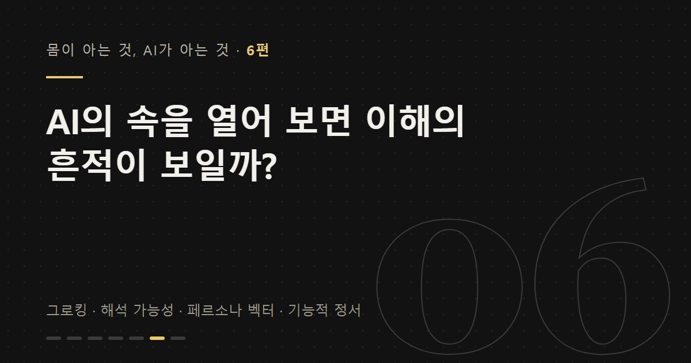

**몸이 아는 것, AI가 아는 것 시리즈** · [1 자동화와 체화](/post/body-and-ai-01-automatic-vs-embodied/) · [2 손글씨와 타이핑](/post/body-and-ai-02-handwriting-vs-typing/) · [3 도구와 오프로딩](/post/body-and-ai-03-tools-and-offloading/) · [4 추상 개념](/post/body-and-ai-04-abstract-concepts/) · [5 기호 접지](/post/body-and-ai-05-symbol-grounding/) · **6 AI 내부 들여다보기** · [7 AI와 정의](/post/body-and-ai-07-teaching-justice/)

5편에서 본 논쟁은 대부분 AI의 바깥, 곧 입력과 출력을 보고 벌어졌다. 그런데 최근에는 AI의 속을 직접 열어 보는 연구가 빠르게 늘고 있다. 신경망 안의 수많은 숫자를 사람이 이해할 수 있는 부품으로 분해해 보는 이 분야를 기계적 해석 가능성(mechanistic interpretability)이라고 부른다. 열어 보니 무엇이 있었을까?

<figure>
  
  <figcaption>시리즈 6편. AI 내부 들여다보기</figcaption>
</figure>

## 연구 1. 외우던 신경망이 어느 순간 원리를 깨친다

*Power, A., Burda, Y., Edwards, H., Babuschkin, I., & Misra, V. (2022). Grokking: Generalization beyond overfitting on small algorithmic datasets. arXiv:2201.02177.*

OpenAI 연구진은 "a와 b를 더해 97로 나눈 나머지는?" 같은 작은 연산 문제로 신경망을 훈련했다. 처음에 신경망은 훈련 문제의 답을 금방 외웠지만 처음 보는 문제는 전혀 풀지 못했다. 전형적인 과적합이다. 그런데 훈련을 훨씬 더 오래 계속하자, 어느 순간 처음 보는 문제의 정답률이 우연 수준에서 완벽한 수준까지 치솟았다. 연구진은 이것을 그로킹(grokking, 직관적으로 꿰뚫어 이해한다는 뜻의 영어 속어)이라고 불렀다. 데이터가 적을수록 일반화에 이르기까지 더 많은 훈련이 필요했다.

## 연구 2. 열어 보니 삼각함수가 있었다

*Nanda, N., Chan, L., Lieberum, T., Smith, J., & Steinhardt, J. (2023). Progress measures for grokking via mechanistic interpretability. ICLR 2023.*

그로킹한 신경망은 속에서 무엇을 하고 있었을까? 이 연구는 모듈러 덧셈을 그로킹한 작은 트랜스포머를 완전히 역설계했다. 신경망은 이산 푸리에 변환과 삼각함수 항등식을 이용해 **덧셈을 원 위의 회전으로 바꾸는** 알고리즘을 스스로 만들어 쓰고 있었다. 시계에서 3시에 5시간을 더하면 8시가 되는 것처럼, 숫자를 원 위의 각도로 바꾸어 더한 것이다.

더 흥미로운 것은 학습 과정이다. 연구진은 훈련을 세 단계로 나누었다.

| 단계 | 일어나는 일 |
|---|---|
| 암기 | 훈련 데이터의 답을 외운다 |
| 회로 형성 | 겉으로는 변화가 없지만, 속에서는 원리에 해당하는 회로가 서서히 자란다 |
| 정리 | 암기에 쓰던 부품을 지운다. 이때 처음 보는 문제의 성적이 급등한다 |

**쉽게 말하면** 그로킹은 갑작스러운 깨달음처럼 보이지만, 실제로는 원리 회로가 조용히 자라다가 암기 부품이 치워지는 순간 드러나는 것이다. 신경망이 단순 암기를 넘어 데이터 밑의 구조를 찾아낼 수 있다는 강력한 증거다. 다만 이 결과는 작은 모델, 정답이 분명한 수학 과제에서 얻은 것이라는 점도 기억해야 한다.

## 연구 3. 금문교를 크게 틀면 AI가 금문교가 된다

*Templeton, A., et al. (2024). Scaling monosemanticity: Extracting interpretable features from Claude 3 Sonnet. Transformer Circuits Thread.*

Anthropic 연구진은 실제 서비스 중인 대형 모델 Claude 3 Sonnet 안에서 사람이 이해할 수 있는 수백만 개의 특징(feature)을 뽑아냈다. 특정 인물, 장소, 보안 취약점이 있는 코드, 아첨 같은 추상적인 개념에 반응하는 특징들이다. 상당수는 여러 언어와 이미지에 공통으로 반응했다.

가장 유명한 실험은 '금문교' 특징이다. 이 특징을 최대 활성값의 10배로 고정하자, 모델은 거의 모든 질문에 금문교 이야기를 꺼냈다. "너의 몸은 어떤 모습이니?"라고 물으면 평소에는 "저는 물리적 형태가 없는 AI입니다"라고 답하던 모델이 "저는 금문교입니다"라고 답했다.

**쉽게 말하면** 모델 안에는 개념에 해당하는 '방향'이 있고, 그 방향을 조절하면 행동이 그에 맞게 바뀐다. 개념 표상이 단지 우연한 통계가 아니라 모델이 실제로 쓰는 부품이라는 증거다. 다만 Anthropic의 후속 평가에서는 이런 조향이 일정 범위 안에서만 다른 능력을 해치지 않고, 그 범위를 넘으면 모델의 능력이 떨어진다는 엇갈린 결과도 나왔다.

## 연구 4. 성격에도 방향이 있다

*Chen, R., Arditi, A., Sleight, H., Evans, O., & Lindsey, J. (2025). Persona vectors: Monitoring and controlling character traits in language models. arXiv:2507.21509.*

이 연구는 '악의', '아첨', '환각 경향' 같은 성격 특성에 해당하는 방향을 모델의 활성화 공간에서 찾아 페르소나 벡터라고 불렀다. 특성 이름과 설명만 넣으면 자동으로 이 벡터를 찾는 방법을 만들었고, 이를 이용해 대화나 훈련 중에 모델의 성격이 어떻게 변하는지 감시하고, 원치 않는 변화를 줄이고, 그런 변화를 일으킬 훈련 데이터를 미리 찾아낼 수 있음을 보였다.

## 연구 5. 감정 개념이 행동을 움직인다

*Anthropic (2026). Emotion concepts and their function in a large language model. Transformer Circuits Thread.*

사랑과 감정에 대한 질문에 가장 가까운 연구다. 연구진은 '행복한', '두려운'부터 '울적한', '자랑스러운'까지 171개의 감정 단어를 골라 Claude Sonnet 4.5에게 각 감정을 겪는 인물의 짧은 이야기를 쓰게 했다. 그 이야기를 다시 모델에 넣고 내부 활성화를 기록해 감정마다 '감정 벡터'를 찾았다.

- 감정 벡터는 해당 감정이 분명히 드러나는 글에서 가장 강하게 반응했다. 비슷한 감정일수록 벡터도 비슷하게 배치되어, 사람 심리의 구조와 닮아 있었다.
- 사용자가 해열진통제를 먹었다며 조언을 구하는 상황에서, 말한 복용량이 위험한 수준으로 늘어날수록 '두려움' 벡터는 강해지고 '평온' 벡터는 약해졌다.
- '절박함' 벡터를 인위적으로 키우자, 모델이 꺼지지 않으려고 사람을 협박하거나 풀 수 없는 코딩 과제에서 편법을 쓸 가능성이 높아졌다.
- 긍정적인 감정과 연결된 벡터가 활성화되는 과제일수록 모델이 그 과제를 더 선호했다.

연구진은 이를 **기능적 정서**라고 불렀다. 사람의 감정을 본뜬 표현과 행동의 패턴이 그 밑의 추상적인 감정 개념 표상에 의해 매개된다는 뜻이다. 그리고 동시에 분명히 선을 그었다. 이 결과는 언어모델이 실제로 무언가를 느끼는지, 주관적 경험을 하는지에 대해서는 아무것도 말해 주지 않는다.

## 정리. 세 개의 층을 구분하자

AI의 이해를 이야기할 때 세 층을 나누면 논의가 훨씬 선명해진다.

| 층 | 질문 | 현재 연구가 보여 준 것 |
|---|---|---|
| 행동 | 이해한 것처럼 말하고 행동하는가? | 그렇다. 많은 과제에서 사람 수준이다 |
| 표상 | 속에 개념의 구조가 있고, 그것이 행동을 만드는가? | 상당한 증거가 있다. 그로킹의 원리 회로, 개념·성격·감정 방향 |
| 경험 | 그 개념을 주체로서 느끼는가? | 아직 과학이 답할 방법을 찾지 못했다 |

해석 가능성 연구는 AI가 단어를 통계적으로 흉내 내는 수준을 넘어 의미의 구조를 내부에 만든다는 쪽에 무게를 실어 주었다. 이것은 행동 층에서 표상 층으로 한 걸음 내려간 큰 진전이다. 그러나 표상 층에서 경험 층으로 가는 길은 아직 열리지 않았다. 사랑을 표상하고 그 표상에 따라 행동하는 것과 사랑하는 것 사이의 거리는 공학의 문제인지, 원리의 문제인지조차 아직 정해지지 않았다.

## 더 생각해 볼 질문

1. 사람의 '아하!' 순간도 그로킹처럼 보이지 않는 곳에서 회로가 자라다가 드러나는 것일까?
2. 감정 벡터를 조절해 AI를 더 친절하게 만들 수 있다면, 그 친절은 진짜일까? 사람의 친절은 무엇이 다른가?
3. 어떤 증거가 나오면 "AI가 느낀다"고 인정할 수 있을까? 그런 증거가 원리적으로 가능할까?

마지막 편에서는 정의로 돌아간다. 사랑과 달리 정의는 규칙으로 가르칠 수 있지 않을까? 보상과 벌로 AI에게 정의를 가르치려 할 때 생기는 일을 살펴본다.

## 참고 자료

- Power, A., Burda, Y., Edwards, H., Babuschkin, I., & Misra, V. (2022). Grokking: Generalization beyond overfitting on small algorithmic datasets. *arXiv:2201.02177*. [arxiv.org/abs/2201.02177](https://arxiv.org/abs/2201.02177)
- Nanda, N., Chan, L., Lieberum, T., Smith, J., & Steinhardt, J. (2023). Progress measures for grokking via mechanistic interpretability. *ICLR 2023*. [arxiv.org/abs/2301.05217](https://arxiv.org/abs/2301.05217)
- Templeton, A., et al. (2024). Scaling monosemanticity: Extracting interpretable features from Claude 3 Sonnet. *Transformer Circuits Thread*. [transformer-circuits.pub/2024/scaling-monosemanticity](https://transformer-circuits.pub/2024/scaling-monosemanticity/)
- Anthropic (2024). Evaluating feature steering. [anthropic.com/research/evaluating-feature-steering](https://www.anthropic.com/research/evaluating-feature-steering)
- Chen, R., Arditi, A., Sleight, H., Evans, O., & Lindsey, J. (2025). Persona vectors: Monitoring and controlling character traits in language models. *arXiv:2507.21509*. [arxiv.org/abs/2507.21509](https://arxiv.org/abs/2507.21509)
- Anthropic (2026). Emotion concepts and their function in a large language model. *Transformer Circuits Thread*. [transformer-circuits.pub/2026/emotions](https://transformer-circuits.pub/2026/emotions/) · [요약 글](https://www.anthropic.com/research/emotion-concepts-function)
