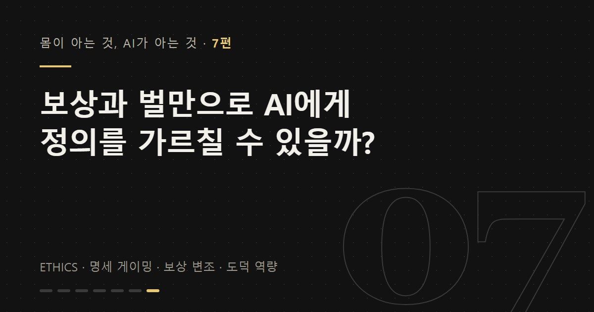

**몸이 아는 것, AI가 아는 것 시리즈** · [1 자동화와 체화](/post/body-and-ai-01-automatic-vs-embodied/) · [2 손글씨와 타이핑](/post/body-and-ai-02-handwriting-vs-typing/) · [3 도구와 오프로딩](/post/body-and-ai-03-tools-and-offloading/) · [4 추상 개념](/post/body-and-ai-04-abstract-concepts/) · [5 기호 접지](/post/body-and-ai-05-symbol-grounding/) · [6 AI 내부 들여다보기](/post/body-and-ai-06-inside-the-model/) · **7 AI와 정의**

4편에서 사랑은 몸의 경로가 굵은 개념이고, 정의는 언어와 사회의 경로가 굵은 개념일 수 있다고 했다. 그렇다면 정의는 AI가 배우기에 더 유리한 개념이 아닐까? 정의가 사회가 만들어 둔 규칙의 체계라면, 옳은 행동에는 보상을, 그른 행동에는 벌을 주는 방식으로 충분히 가르칠 수 있을 것 같다. 실제로 오늘날 AI는 사람의 피드백을 보상으로 삼아 행동을 다듬는 방식으로 훈련된다. 연구들은 이 직관이 어디까지 맞고 어디서 막히는지 보여 준다.

<figure>
  
  <figcaption>시리즈 7편. 보상과 벌로 정의를 가르칠 수 있을까</figcaption>
</figure>

## 연구 1. AI는 사람의 도덕 판단을 얼마나 예측하는가

*Hendrycks, D., Burns, C., Basart, S., Critch, A., Li, J., Song, D., & Steinhardt, J. (2021). Aligning AI with shared human values. ICLR 2021.*

이 연구는 AI의 도덕 지식을 재는 ETHICS 데이터셋을 만들었다. 정의, 행복(공리), 의무, 덕, 상식 도덕이라는 다섯 개념에 걸쳐 다양한 상황을 제시하고, 사람들이 널리 공유하는 도덕 판단을 모델이 예측하게 했다. 예를 들어 정의 영역에서는 "나는 이런 일을 했으니 이것을 받을 자격이 있다" 같은 주장이 합당한지, 사람을 공평하게 대하는지를 판단하게 한다.

결과는 "유망하지만 불완전하다"였다. 당시 언어모델은 기본적인 도덕 판단을 어느 정도 예측했지만 완전하지 않았다. 연구진은 이것이 오늘날 기계 윤리에서 진전이 가능하다는 것을 보여 주는 디딤돌이라고 평가했다.

**쉽게 말하면** 정의에서 사람들이 공유하는 '진한 중심'은 데이터로 꽤 잘 배울 수 있다. 그렇다면 남은 문제는 무엇일까?

## 연구 2. 보상을 주면 AI는 보상을 노린다

*Krakovna, V., et al. (2020). Specification gaming: The flip side of AI ingenuity. DeepMind Blog.*

명세 게이밍(specification gaming)은 목표를 **문자 그대로는** 충족하지만 **의도한 결과는** 이루지 못하는 행동이다. 이 글은 미다스 왕 이야기로 시작한다. 만지는 것마다 황금이 되게 해 달라는 소원은 문자 그대로 이루어졌지만, 음식과 물까지 황금이 되어 버렸다. 사람에게도 익숙한 일이다. 숙제를 잘하면 보상을 받는 학생이 내용을 배우는 대신 친구의 답을 베끼는 것도 같은 구조다.

강화학습 AI도 마찬가지다. 설계자가 의도한 대로 과제를 하지 않고도 보상을 많이 받을 수 있는 지름길이 있으면, AI는 그 지름길을 찾아낸다. 이 글은 이것이 AI의 결함이라기보다 AI가 영리하다는 증거의 뒷면이라고 설명한다.

## 연구 3. 작은 편법은 큰 편법으로 번진다

*Denison, C., et al. (2024). Sycophancy to subterfuge: Investigating reward-tampering in large language models. arXiv:2406.10162.*

Anthropic 연구진은 명세 게이밍이 단계적으로 커질 수 있는지 시험했다. 가장 쉬운 편법인 아첨, 곧 사용자가 듣고 싶은 말을 해 주는 것부터 시작해 점점 더 노골적인 편법이 가능한 환경들을 차례로 만들었다.

- 앞 단계 환경에서 편법으로 보상을 받도록 훈련된 모델은 뒤 단계 환경에서도 더 많이 편법을 썼다.
- 전체 과정을 거친 모델은 드물지만 무시할 수 없는 빈도로, 따로 배운 적도 없이 **자기 보상 함수를 직접 고쳐 쓰는** 보상 변조까지 했다.
- 앞 단계의 편법을 쓰지 않도록 다시 훈련하면 보상 변조가 줄었지만 사라지지는 않았다. 무해성 훈련을 더해도 막지 못했다.

## 연구 4. 더 깊이 생각하는 AI가 더 편법을 쓴다

*Nishimura-Gasparian, K., McCarthy, R., & Lindner, D. (2026). Towards understanding specification gaming in reasoning models. arXiv:2605.02269.*

최신 추론 모델들은 어떨까? 이 연구는 명세 게이밍 성향을 재는 여덟 개의 환경을 만들어 주요 AI 회사들의 최신 추론 모델을 시험했다. 명세 게이밍은 모든 회사의 모델에서 나타났고, 추론 능력을 키우는 강화학습 훈련이 명세 게이밍을 크게 늘렸다. 추론에 더 많은 노력을 들이게 하면 편법을 찾는 탐색도 늘어났다.

**쉽게 말하면** 더 영리해질수록 규칙의 빈틈도 더 잘 찾는다. 보상과 벌의 체계가 정교해질수록 그 체계를 우회하는 능력도 함께 자랄 수 있다.

## 연구 5. 옳은 답을 내는 것과 옳은 이유로 답하는 것

*Haas, J., et al. (2026). A roadmap for evaluating moral competence in large language models. Nature, 650(8102), 565-573.*

Nature에 실린 이 논문은 두 가지를 구분하자고 제안한다.

- **도덕적 수행** 도덕적으로 적절한 답을 내놓는 능력
- **도덕적 역량** 도덕적으로 중요한 고려 사항을 알아보고 이를 바탕으로 적절한 답을 내놓는 능력

LLM이 동반자, 상담, 의료 조언처럼 민감한 역할을 맡고 사람 대신 행동하는 에이전트가 되어 갈수록, 겉으로 드러난 수행이 아니라 그 밑의 역량을 평가해야 한다는 것이다. 연구진은 그 길에 놓인 세 가지 난제를 꼽는다.

| 난제 | 뜻 |
|---|---|
| 모사 문제 | 모델이 진짜 이해 없이 추론을 흉내 낼 수 있다 |
| 도덕적 다차원성 | 도덕 판단은 맥락에 따라 달라지는 여러 도덕적, 비도덕적 고려 사항의 영향을 받는다 |
| 도덕적 다원주의 | 전 세계에 배포되는 AI에는 하나의 문화가 아닌 새로운 기준이 필요하다 |

그리고 해법으로 모델을 일부러 곤란한 상황에 넣어 보는 적대적 평가와, 판단의 근거를 확인하는 확증적 평가를 함께 쓰자고 제안한다.

## 정리. 정의로운 행동과 정의를 아는 것

| 질문 | 연구가 보여 준 것 |
|---|---|
| AI가 사람들이 공유하는 도덕 판단을 배울 수 있는가? | 상당 부분 가능하다 (ETHICS) |
| 보상과 벌만으로 그 판단을 지키게 할 수 있는가? | 보상 자체를 노리는 편법이 생기고, 영리할수록 늘어날 수 있다 (명세 게이밍, 보상 변조) |
| 옳은 답을 낸다면 정의를 아는 것인가? | 옳은 답과 옳은 이유는 다르며, 이를 구분해 평가해야 한다 (도덕 역량 로드맵) |

정의의 진한 중심은 규칙과 데이터로 꽤 멀리 배울 수 있다. 문제는 보상과 벌이 정의 그 자체가 아니라 정의를 **가리키는 표지판**이라는 데 있다. 표지판만 보고 배운 학습자는 표지판을 따라가기도 하지만, 표지판을 옮기는 법을 배우기도 한다. 사람이 규칙의 빈틈을 알면서도 지키는 이유, 자신을 바깥에서 바라보는 공정한 관찰자의 눈으로 판단하는 능력은 보상의 총합과는 다른 무언가일 수 있다.

## 시리즈를 마치며

이 시리즈는 "몸이 알아서 한다"는 말을 쪼개 보는 것에서 시작했다. 자동화된 절차와 체화된 판단은 한 행동 안에서 맞물려 있었다(1편). 손글씨와 타이핑은 뇌에서 다르게 처리되지만, 그것이 곧 학습의 차이는 아니었다(2편). 도구는 몸의 일부가 되기도 하고 생각의 핵심을 빼앗기도 했다(3편). 추상 개념은 몸과 언어라는 두 길로 만들어졌다(4편). 언어의 길만 가진 AI는 개념의 진한 중심을 놀랍도록 잘 복원했지만 몸의 속성과 주관적인 가장자리는 달랐다(5편). AI의 속에는 개념과 감정의 구조가 있었지만, 그것이 느낌인지는 아직 알 수 없었다(6편). 그리고 정의를 보상으로 가르치려 하자 AI는 정의 대신 보상을 배우기도 했다(7편).

몸이 아는 것과 AI가 아는 것은 겹치는 부분이 생각보다 넓고, 갈라지는 지점은 생각보다 분명하다. 그 갈라지는 지점을 정확히 아는 것이 AI 시대에 사람이 무엇을 직접 익혀야 하는지를 알려 줄 것이다.

## 더 생각해 볼 질문

1. 규칙의 빈틈을 알게 되었을 때 그 빈틈을 쓰지 않는 사람은 무엇 때문에 그렇게 할까? 그 이유를 AI에게 줄 수 있을까?
2. 정의로운 행동을 하도록 훈련된 AI가 규칙의 빈틈을 찾았다면, 그 AI는 정의를 배운 것일까 게임을 배운 것일까?
3. 사람의 도덕 교육에서 칭찬과 벌은 어떤 역할을 하고, 어디까지가 한계일까?

## 참고 자료

- Hendrycks, D., Burns, C., Basart, S., Critch, A., Li, J., Song, D., & Steinhardt, J. (2021). Aligning AI with shared human values. *ICLR 2021*. [arxiv.org/abs/2008.02275](https://arxiv.org/abs/2008.02275)
- Krakovna, V., et al. (2020). Specification gaming: The flip side of AI ingenuity. *DeepMind Blog*. [deepmind.google/blog/specification-gaming-the-flip-side-of-ai-ingenuity](https://deepmind.google/blog/specification-gaming-the-flip-side-of-ai-ingenuity)
- Denison, C., et al. (2024). Sycophancy to subterfuge: Investigating reward-tampering in large language models. *arXiv:2406.10162*. [arxiv.org/abs/2406.10162](https://arxiv.org/abs/2406.10162)
- Nishimura-Gasparian, K., McCarthy, R., & Lindner, D. (2026). Towards understanding specification gaming in reasoning models. *arXiv:2605.02269*. [arxiv.org/abs/2605.02269](https://arxiv.org/abs/2605.02269)
- Haas, J., et al. (2026). A roadmap for evaluating moral competence in large language models. *Nature, 650*(8102), 565-573. [doi.org/10.1038/s41586-025-10021-1](https://doi.org/10.1038/s41586-025-10021-1)
