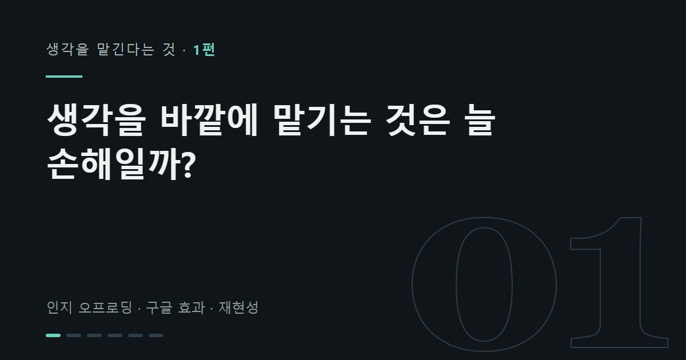

**생각을 맡긴다는 것 시리즈** · **1 맡김의 득실** · [2 앎의 착각](/post/outsourcing-mind-02-illusion-of-knowing/) · [3 읽기와 믿기](/post/outsourcing-mind-03-reading-and-trust/) · [4 대답하는 AI](/post/outsourcing-mind-04-answering-ai/) · [5 엇갈리는 증거](/post/outsourcing-mind-05-mixed-evidence/) · [6 다시 내 것으로](/post/outsourcing-mind-06-reclaiming-thought/)

플라톤의 『파이드로스』에는 오래된 이야기가 나온다. 문자를 발명한 신 테우트가 이것이 사람의 기억을 좋게 하고 지혜롭게 만들 것이라고 자랑하자, 왕 타무스는 정반대로 답한다. 사람들은 문자에 기대어 스스로 기억하기를 멈추고, 배우지 않고도 많이 아는 것처럼 착각하게 될 것이라고. 2,400년 전의 이 걱정은 계산기, 검색엔진, 그리고 생성형 AI가 나올 때마다 다시 등장했다.

그렇다면 생각을 바깥에 맡기는 것은 정말 손해일까? 이번 편에서는 이 오래된 질문을 실험으로 다룬 연구들을 살펴본다.

<figure>
  
  <figcaption>시리즈 1편. 생각을 바깥에 맡기는 것의 득실</figcaption>
</figure>

## 연구 1. 생각의 짐을 바깥에 내려놓는 행동

*Risko, E. F., & Gilbert, S. J. (2016). Cognitive offloading. Trends in Cognitive Sciences, 20(9), 676-688.*

손가락으로 세기, 장보기 목록 적기, 알람 맞추기. 이처럼 몸을 움직이거나 바깥 도구를 써서 머릿속 부담을 줄이는 행동을 **인지 오프로딩**이라고 한다. 이 리뷰의 핵심은 사람이 "내 기억력으로 충분할까?"라는 메타인지적 판단에 따라 맡길지 말지를 정하며, 그 판단이 늘 정확하지는 않다는 것이다.

**쉽게 말하면** 사람은 원래 생각을 바깥에 맡기는 존재다. 문제는 맡기느냐가 아니라, 맡길지 말지를 정하는 나의 판단이 얼마나 정확하냐다. (확장된 마음과 도구의 체화는 [몸이 아는 것, AI가 아는 것 3편](/post/body-and-ai-03-tools-and-offloading/)에서 더 자세히 다뤘다.)

## 연구 2. 나중에 찾을 수 있으면 덜 기억한다, 이른바 구글 효과

*Sparrow, B., Liu, J., & Wegner, D. M. (2011). Google effects on memory. Science, 333(6043), 776-778.*

이 연구는 네 개의 실험으로 큰 화제가 되었다.

- 어려운 퀴즈를 받은 뒤에는 '구글', '야후' 같은 컴퓨터 관련 단어에 더 빨리 반응했다. 모르는 게 생기면 머리가 자동으로 검색을 떠올린다는 해석이었다.
- 내용이 저장될 것이라고 들은 사람은 지워질 것이라고 들은 사람보다 그 내용을 덜 기억했다.
- 사람들은 정보 자체보다 그 정보가 '어느 폴더에 있는지'를 더 잘 기억했다.

연구진은 인터넷이 일종의 **거래적 기억(transactive memory)**, 즉 내가 다 기억하지 않아도 누가 아는지만 알면 되는 공동 기억 장치가 되었다고 보았다.

## 연구 3. 그런데 그 유명한 실험은 다시 해 보니 나오지 않았다

*Camerer, C. F., et al. (2018). Evaluating the replicability of social science experiments in Nature and Science between 2010 and 2015. Nature Human Behaviour, 2(9), 637-644.*

연구자 24명이 『네이처』와 『사이언스』에 실린 사회과학 실험 21편을 훨씬 큰 표본으로 다시 해 보았다. 구글 효과 논문에서는 첫 번째 실험, 곧 어려운 질문 뒤에 컴퓨터 단어에 더 빨리 반응한다는 '구글 스트룹 효과'를 다시 검증했는데, 이 효과는 재현되지 않았다. 원저자가 설계 차이를 지적하자 2020년에 원래 설계에 더 가깝게 다시 해 본 Hesselmann의 연구(PeerJ)도 결정적인 증거를 찾지 못했다.

**주의할 점** 재현에 실패한 것은 첫 번째 실험이다. "저장된다고 믿으면 덜 기억한다"는 나머지 결과까지 모두 부정된 것은 아니다. 하지만 "인터넷이 우리 뇌를 바꿨다"는 대중적 이야기의 상징이 된 실험이 생각보다 단단하지 않았다는 사실은 기억해 둘 만하다.

## 연구 4. 저장하면 오히려 새것을 더 잘 기억한다

*Storm, B. C., & Stone, S. M. (2015). Saving-enhanced memory. Psychological Science, 26(2), 182-188.*

참가자들은 단어 목록이 담긴 파일 A를 공부한 뒤, 이를 저장하거나 저장하지 않고 파일 B를 공부했다. 그러자 파일 A를 저장한 사람이 파일 B를 더 잘 기억했다. 앞의 내용을 머릿속에 붙잡고 있을 필요가 없어지자 새 내용을 받아들일 여유가 생긴 것이다. 흥미롭게도 저장이 믿을 만하지 않을 때, 또는 저장할 내용이 너무 적어 방해가 되지 않을 때는 이 효과가 사라졌다.

**쉽게 말하면** 믿을 수 있는 곳에 맡기면 머리가 가벼워져 다음 것을 더 잘 담는다. 외주화가 늘 손해인 것은 아니다.

## 연구 5. 수행은 오르고 기억은 내려간다, 그러나 목표가 있으면 다르다

*Grinschgl, S., Papenmeier, F., & Meyerhoff, H. S. (2021). Consequences of cognitive offloading: Boosting performance but diminishing memory. Quarterly Journal of Experimental Psychology, 74(9), 1477-1496.*

참가자들은 화면 한쪽의 도형 배치를 다른 쪽에 그대로 옮기는 과제를 했다(실험마다 172명). 원본 창을 마음대로 다시 열어 볼 수 있게 하면, 즉 기억을 화면에 맡기면 과제는 더 빨리 끝냈지만 예고 없이 본 기억 시험에서는 점수가 낮았다.

반전은 세 번째 실험에 있다. 원본을 최대한 다시 보도록 강제하되 "나중에 기억 시험이 있다"고 미리 알려 준 집단은 기억의 손실을 거의 다 만회했다.

**쉽게 말하면** 맡기면 당장은 편하고 빨라지지만 머리에 남는 것은 줄어든다. 그런데 "이건 내가 결국 알아야 한다"는 목표가 있으면, 맡기면서도 배울 수 있다.

## 정리. 맡김의 득과 실

| 연구 | 맡겼을 때 생긴 일 | 핵심 조건 |
|---|---|---|
| Sparrow 외(2011) | 저장된다고 믿으면 덜 기억한다 | 일부 실험은 재현 실패 |
| Storm & Stone(2015) | 맡긴 덕분에 새 내용을 더 잘 기억한다 | 저장을 믿을 수 있을 때 |
| Grinschgl 외(2021) | 수행은 오르고 기억은 내려간다 | 배워야 한다는 목표가 있으면 손실이 줄어든다 |

## 날카롭게 보기

**"맡기면 바보가 된다"는 말은 증거보다 앞서 달려 왔다.** 타무스의 경고부터 "구글이 우리를 멍청하게 만드는가"라는 유명한 칼럼까지, 기술이 생각을 망친다는 이야기는 늘 설득력 있게 들렸다. 하지만 그 이야기를 상징하던 실험은 재현되지 않았고, 다른 실험들은 맡김이 오히려 기억을 돕는 조건을 보여 주었다. 실제 증거가 가리키는 것은 '손해'가 아니라 **'맞바꿈'**이다. 당장의 수행과 장기적인 기억을 맞바꾸는 것이고, 그 저울의 기울기는 학습자가 무엇을 목표로 삼느냐에 따라 달라진다.

그래서 교실에서 던질 질문은 "AI를 써도 되는가?"보다 **"이 과제에서 학생이 끝내 머리에 남겨야 할 것은 무엇인가?"**에 가깝다. 그것이 정해지면 나머지는 맡겨도 된다. 정해지지 않으면 무엇을 맡겨도 위험하다.

## 더 생각해 볼 질문

1. 내가 바깥에 맡겨서 오히려 더 잘하게 된 일과, 맡긴 뒤로 할 수 없게 된 일은 각각 무엇일까?
2. 학생에게 "이건 나중에 시험에 나온다"고 말하는 것은 Grinschgl의 실험으로 보면 어떤 효과를 낼까?
3. 생성형 AI는 기억만이 아니라 추론까지 맡는다. Storm과 Stone의 '믿을 만한 저장' 조건은 AI에도 똑같이 적용될까?

다음 편에서는 맡긴 지식이 왜 내 것처럼 느껴지는지, 곧 '앎의 착각'을 다룬 연구들을 살펴본다.

## 참고 자료

- Risko, E. F., & Gilbert, S. J. (2016). Cognitive offloading. *Trends in Cognitive Sciences, 20*(9), 676-688. [doi.org/10.1016/j.tics.2016.07.002](https://doi.org/10.1016/j.tics.2016.07.002)
- Sparrow, B., Liu, J., & Wegner, D. M. (2011). Google effects on memory: Cognitive consequences of having information at our fingertips. *Science, 333*(6043), 776-778. [doi.org/10.1126/science.1207745](https://doi.org/10.1126/science.1207745)
- Camerer, C. F., Dreber, A., Holzmeister, F., et al. (2018). Evaluating the replicability of social science experiments in Nature and Science between 2010 and 2015. *Nature Human Behaviour, 2*(9), 637-644. [doi.org/10.1038/s41562-018-0399-z](https://doi.org/10.1038/s41562-018-0399-z)
- Hesselmann, G. (2020). No conclusive evidence that difficult general knowledge questions cause a "Google Stroop effect". A replication study. *PeerJ, 8*, e10325. [peerj.com/articles/10325](https://peerj.com/articles/10325)
- Storm, B. C., & Stone, S. M. (2015). Saving-enhanced memory. *Psychological Science, 26*(2), 182-188. [doi.org/10.1177/0956797614559285](https://doi.org/10.1177/0956797614559285)
- Grinschgl, S., Papenmeier, F., & Meyerhoff, H. S. (2021). Consequences of cognitive offloading: Boosting performance but diminishing memory. *Quarterly Journal of Experimental Psychology, 74*(9), 1477-1496. [doi.org/10.1177/17470218211008060](https://doi.org/10.1177/17470218211008060)
- 플라톤. 『파이드로스』 274c-275b (테우트와 타무스 이야기).
- 함께 읽기: [도구를 쓰는 것은 게으름일까 영리함일까?](/post/body-and-ai-03-tools-and-offloading/) · [AI 챗봇 사용, 학생들의 사고력을 덜어내는가 변화시키는가?](/post/cognitive-offloading-in-the-age-of-ai/)
