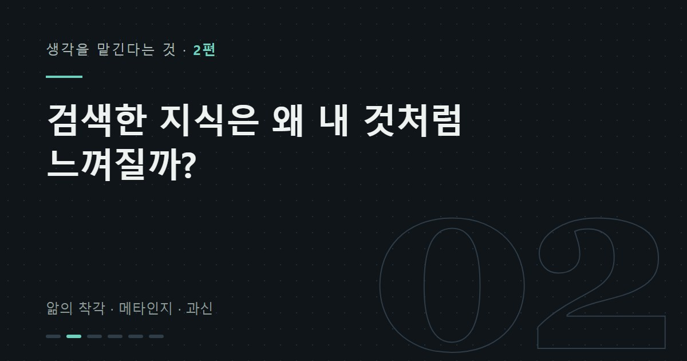

**생각을 맡긴다는 것 시리즈** · [1 맡김의 득실](/post/outsourcing-mind-01-offloading-tradeoffs/) · **2 앎의 착각** · [3 읽기와 믿기](/post/outsourcing-mind-03-reading-and-trust/) · [4 대답하는 AI](/post/outsourcing-mind-04-answering-ai/) · [5 엇갈리는 증거](/post/outsourcing-mind-05-mixed-evidence/) · [6 다시 내 것으로](/post/outsourcing-mind-06-reclaiming-thought/)

지퍼는 어떻게 작동할까? 대부분은 "당연히 안다"고 생각한다. 그런데 막상 단계별로 설명해 보라고 하면 말문이 막힌다. 심리학에서는 이를 **설명 깊이의 착각**이라고 부른다. 1편에서 본 것처럼 사람은 늘 생각을 바깥에 맡겨 왔다. 문제는 맡긴 것과 내가 가진 것의 경계가 흐려질 때 생긴다. 이번 편은 그 경계가 어떻게 흐려지는지 보여 주는 연구들이다.

<figure>
  
  <figcaption>시리즈 2편. 검색과 AI가 만드는 앎의 착각</figcaption>
</figure>

## 연구 1. 검색하고 나면 상관없는 것까지 더 안다고 느낀다

*Fisher, M., Goddu, M. K., & Keil, F. C. (2015). Searching for explanations: How the Internet inflates estimates of internal knowledge. Journal of Experimental Psychology: General, 144(3), 674-687.*

예일대 연구진은 9개의 실험을 했다. 한 집단은 "지퍼는 어떻게 작동하나?" 같은 질문의 답을 인터넷에서 찾았고, 다른 집단은 검색 없이 답했다. 그다음 두 집단 모두에게 전혀 다른 분야의 질문을 얼마나 잘 설명할 수 있을지 스스로 평가하게 했다.

- 검색을 한 집단은 **검색하지 않은 분야**에 대해서도 자기가 더 잘 설명할 수 있다고 평가했다(효과 크기 d = 0.50).
- 검색해도 답을 찾지 못한 경우에도 이 효과가 나타났다.
- 뇌 활동 정도가 다른 fMRI 사진들을 보여 주며 지금 내 뇌와 가장 비슷한 것을 고르게 하자, 검색한 사람은 더 활발한 뇌 사진을 골랐다.

**쉽게 말하면** 검색할 수 있다는 사실이 "내가 안다"는 느낌으로 바뀐다. 접근할 수 있는 지식과 내 머릿속 지식을 구분하지 못하는 것이다.

이 결과는 이후 Eliseev와 Marsh(2023)가 4개의 실험으로 다시 확인했다. 같은 설명이라도 그냥 읽은 사람보다 직접 검색해서 찾은 사람이 자기 설명 능력을 더 높게 평가했다.

## 연구 2. 구글의 지식을 내 기억으로 착각한다

*Ward, A. F. (2021). People mistake the internet's knowledge for their own. PNAS, 118(43), e2105061118.*

8개의 실험에 1,917명이 참여했다. 상식 문제를 구글로 풀게 했더니, 예상대로 정답은 더 많이 맞혔다. 놀라운 점은 그다음이다.

- 구글을 쓴 사람은 "답을 어디서 찾을지 안다"는 자신감만이 아니라 **"나는 기억력이 좋다", "나는 똑똑하다"는 자신감**까지 높아졌다.
- 앞으로 인터넷 없이 문제를 풀 때도 더 많이 맞힐 것이라고 예측했다. 당연히 틀린 예측이다.

**쉽게 말하면** 정보가 손끝에 있으면 그것이 원래 내 머릿속에서 나온 것처럼 느낀다. 그래서 인터넷이 끊긴 순간 과신이 드러난다.

## 연구 3. AI를 쓰면 누구나 자기 실력을 과대평가한다

*Fernandes, D., Villa, S., Nicholls, S., et al. (2026). AI makes you smarter but none the wiser: The disconnect between performance and metacognition. Computers in Human Behavior, 175, 108779.*

핀란드 알토대학 연구진은 약 500명에게 미국 로스쿨 입학시험(LSAT)의 논리 추론 문제를 풀게 했다. 절반은 ChatGPT를 썼다. 문제를 풀 때마다 자기가 얼마나 잘했는지 예측하게 했고, 예측이 정확하면 보상을 더 주었다.

- ChatGPT를 쓴 사람은 실제로 점수가 더 높았다.
- 그런데 **모두가** 자기 점수를 과대평가했다. 원래 못하는 사람일수록 자기를 과대평가하는 '더닝-크루거 효과'가 AI 앞에서는 사라졌다. 모두가 똑같이 과신했기 때문이다.
- 더 놀라운 결과는, 스스로 **AI 리터러시가 높다고 생각하는 사람일수록 더 과신했다**는 점이다.
- 대부분은 문제를 복사해 붙여 넣고 한 번 묻고 끝냈다. 답을 의심하거나 다시 묻는 경우는 드물었다.

**쉽게 말하면** AI는 점수를 올려 주지만, 내가 얼마나 잘했는지 판단하는 눈은 흐리게 만든다. 연구진의 표현대로 "더 똑똑하게, 그러나 더 현명하지는 않게" 만든다.

## 연구 4. 더 많이 만들지만 덜 이해하는 과학

*Messeri, L., & Crockett, M. J. (2024). Artificial intelligence and illusions of understanding in scientific research. Nature, 627(8002), 49-58.*

인류학자와 심리학자가 함께 쓴 이 논문은 개인이 아니라 과학 공동체 전체를 걱정한다. 연구자들은 AI를 정답을 알려 주는 신탁, 사람 참가자를 대신하는 대리인, 방대한 자료를 분석하는 계량가, 공정한 심판처럼 기대한다. 그런데 이런 기대는 세 가지 착각을 낳을 수 있다.

- **설명 깊이의 착각**: AI가 설명해 주었으니 내가 이해했다고 느낀다.
- **탐색 범위의 착각**: AI가 잘 다루는 질문만 보면서 모든 가능성을 탐색했다고 느낀다.
- **객관성의 착각**: AI는 관점이 없으니 중립적이라고 느낀다.

저자들은 그 결과 과학이 "더 많이 생산하지만 덜 이해하는" 단계로 들어설 수 있으며, 비슷한 방법과 질문만 남는 '단일 경작'이 될 위험이 있다고 경고한다.

## 정리. 앎의 착각은 어떻게 생기나

| 연구 | 바깥 도구 | 생긴 착각 |
|---|---|---|
| Fisher 외(2015) | 검색 | 검색하지 않은 분야까지 더 안다고 느낌 |
| Ward(2021) | 구글 | 찾은 지식을 내 기억으로 착각, 미래 실력 과대 예측 |
| Fernandes 외(2026) | ChatGPT | 점수는 오르지만 모두가 과신, AI 리터러시가 높을수록 더 과신 |
| Messeri & Crockett(2024) | 과학 연구용 AI | 설명 깊이, 탐색 범위, 객관성의 착각 |

## 날카롭게 보기

**문제는 무지가 아니라 보정(calibration)이다.** 네 연구 모두에서 사람들은 도구 덕분에 실제로 더 잘했다. 망가진 것은 실력이 아니라 **"나는 얼마나 아는가"를 재는 눈금**이다. 이 눈금이 어긋나면 언제 도구를 의심해야 하는지, 언제 스스로 더 공부해야 하는지 판단할 근거가 사라진다.

Fernandes 연구의 반전은 특히 교육에 불편한 질문을 던진다. 우리는 흔히 'AI 리터러시 교육'을 해법으로 내세운다. 그런데 도구를 잘 다룬다는 자신감이 오히려 과신을 키웠다. 프롬프트를 잘 쓰는 법을 아는 것과 내 판단의 한계를 아는 것은 다른 능력이다. AI 리터러시가 기능 교육에 머문다면 착각을 줄이기는커녕 더 세련되게 만들 수 있다. 필요한 것은 도구 사용법보다 **"이 답에서 내가 직접 확인한 것은 무엇인가?"를 묻는 습관**이다.

## 더 생각해 볼 질문

1. 오늘 AI나 검색으로 해결한 문제 하나를 골라, 도구 없이 다시 설명해 보자. 어디서 막히는가?
2. 학생이 자기 답에 확신도(예: 0~100%)를 함께 적게 하면 무엇이 달라질까?
3. Messeri와 Crockett이 말한 '객관성의 착각'은 학교 수업에서 어떤 모습으로 나타날 수 있을까?

다음 편에서는 반대 방향의 질문을 던진다. 책과 전문가를 믿는 것은 정말 생각을 멈추는 일일까?

## 참고 자료

- Fisher, M., Goddu, M. K., & Keil, F. C. (2015). Searching for explanations: How the Internet inflates estimates of internal knowledge. *Journal of Experimental Psychology: General, 144*(3), 674-687. [doi.org/10.1037/xge0000070](https://doi.org/10.1037/xge0000070)
- Eliseev, E. D., & Marsh, E. J. (2023). Understanding why searching the internet inflates confidence in explanatory ability. *Applied Cognitive Psychology, 37*(4), 711-720. [doi.org/10.1002/acp.4058](https://doi.org/10.1002/acp.4058)
- Ward, A. F. (2021). People mistake the internet's knowledge for their own. *Proceedings of the National Academy of Sciences, 118*(43), e2105061118. [doi.org/10.1073/pnas.2105061118](https://doi.org/10.1073/pnas.2105061118)
- Fernandes, D., Villa, S., Nicholls, S., Haavisto, O., Buschek, D., Schmidt, A., Kosch, T., Shen, C., & Welsch, R. (2026). AI makes you smarter but none the wiser: The disconnect between performance and metacognition. *Computers in Human Behavior, 175*, 108779. [doi.org/10.1016/j.chb.2025.108779](https://doi.org/10.1016/j.chb.2025.108779)
- Messeri, L., & Crockett, M. J. (2024). Artificial intelligence and illusions of understanding in scientific research. *Nature, 627*(8002), 49-58. [doi.org/10.1038/s41586-024-07146-0](https://doi.org/10.1038/s41586-024-07146-0)
- 함께 읽기: [AI가 과연 생각의 수고를 없애는가?](/post/does-ai-remove-cognitive-effort/)
