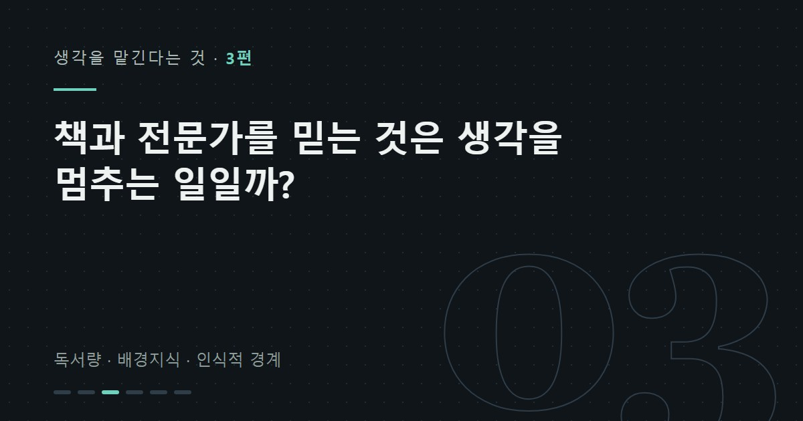

**생각을 맡긴다는 것 시리즈** · [1 맡김의 득실](/post/outsourcing-mind-01-offloading-tradeoffs/) · [2 앎의 착각](/post/outsourcing-mind-02-illusion-of-knowing/) · **3 읽기와 믿기** · [4 대답하는 AI](/post/outsourcing-mind-04-answering-ai/) · [5 엇갈리는 증거](/post/outsourcing-mind-05-mixed-evidence/) · [6 다시 내 것으로](/post/outsourcing-mind-06-reclaiming-thought/)

AI 이야기가 나오면 자주 따라오는 말이 있다. "AI 답을 그대로 믿는 건 새로운 일이 아니다. 우리는 원래 유명한 저자의 책을 외우고 전문가의 말을 믿어 왔다." 이 말에 따르면 책 읽기와 전문가 신뢰는 생각의 외주화이고, AI 맹신은 그 오래된 습관의 연장이다.

그럴듯하다. 그런데 연구는 이 이야기를 그대로 지지할까? 이번 편은 일부러 **반대편 증거**를 모았다.

<figure>
  
  <figcaption>시리즈 3편. 읽기와 믿기는 생각의 반대일까</figcaption>
</figure>

## 연구 1. 많이 읽는 사람은 정말로 더 잘 이해한다

*Mol, S. E., & Bus, A. G. (2011). To read or not to read: A meta-analysis of print exposure from infancy to early adulthood. Psychological Bulletin, 137(2), 267-296.*

유아부터 대학생까지 7,669명이 참여한 99편의 연구를 종합했다. 여가 시간에 얼마나 많이 읽는지(독서량)는 독해력, 어휘, 철자 능력과 중간에서 강한 수준으로 관련되었다. 그리고 그 관계는 나이가 들수록 강해졌다. 독서량이 언어 능력의 차이를 설명하는 비율은 유치원에서 12%, 중학교에서 19%, 고등학교에서 30%, 대학에서 34%였다.

연구진은 이를 **상향 나선**으로 설명한다. 잘 읽는 아이가 더 많이 읽고, 많이 읽어서 더 잘 읽게 된다. 읽기가 서툰 아이도 스스로 읽는 시간에서 도움을 받았다.

**쉽게 말하면** "많이 읽어도 생각은 안 한다"는 냉소는 수사로는 날카롭지만, 증거로는 약하다. 평균적으로 읽기는 이해의 재료를 쌓는다.

## 연구 2. 그런데 읽기 점수가 높아도 못하는 것이 있다

*OECD. (2021). 21st-Century Readers: Developing Literacy Skills in a Digital World. PISA, OECD Publishing.*

PISA 2018 읽기 평가에는 글 속 진술이 사실인지 의견인지 구별하는 문항이 있었다. OECD는 이 문항의 나라별 정답률을 따로 분석했다. 한국은 읽기 총점이 OECD 평균보다 높았지만, 이 문항의 정답률은 30%에도 미치지 못해 OECD 평균보다 낮았다. 반대로 읽기 총점이 평균보다 낮은 튀르키예는 정답률이 63%로 최상위권이었다.

OECD는 한 가지 단서를 덧붙였다. 학교에서 디지털 정보 다루는 법을 배운 학생 비율이 높은 나라일수록 이 문항의 정답률도 높았다.

**쉽게 말하면** 많이 읽는 것과 출처를 따지며 읽는 것은 다른 기술이다. 그리고 후자는 저절로 생기지 않고 **가르쳐야** 생긴다.

## 연구 3. 비판적 사고는 지식 없이 작동하지 않는다

*Willingham, D. T. (2007). Critical thinking: Why is it so hard to teach? American Educator, 31(2), 8-19.*

인지과학자 Willingham은 비판적 사고가 자전거 타기처럼 한 번 배우면 어디에나 쓸 수 있는 기술이 아니라고 말한다. 생각하는 과정은 생각하는 **내용**, 곧 영역 지식과 얽혀 있다. 학생에게 "여러 관점에서 보라"고 아무리 말해도, 그 주제에 대해 아는 것이 별로 없으면 여러 관점에서 볼 수 없다.

**쉽게 말하면** 의심하려면 먼저 알아야 한다. 무엇이 이상한지 알아차리는 것 자체가 지식의 일이다. AI의 그럴듯한 오답을 잡아내는 힘도 결국 머릿속 지식에서 나온다.

## 연구 4. 전문가를 믿는 것은 합리적일 수 있다

*Hardwig, J. (1985). Epistemic dependence. The Journal of Philosophy, 82(7), 335-349.*

철학자 Hardwig는 도발적인 결론을 내놓았다. 내가 전문가가 아닌 영역에서는, 상대가 좋은 근거를 갖고 있다고 믿을 이유가 있는 한 그 사람에게 기대는 것이 **합리적**이다. 그 근거를 내가 직접 확인하지 못하더라도 말이다. 현대 과학은 수십, 수백 명의 연구자가 서로의 작업을 믿지 않으면 성립할 수 없다. 누구도 모든 것을 혼자 검증할 수 없기 때문이다.

**쉽게 말하면** 의사의 진단을 믿는 것은 생각을 포기하는 것이 아니라 분업을 하는 것이다. 문제는 의존 자체가 아니라 **무엇을 근거로** 의존하느냐다.

## 연구 5. 사람은 원래 그렇게 쉽게 믿지 않는다

*Sperber, D., Clément, F., Heintz, C., Mascaro, O., Mercier, H., Origgi, G., & Wilson, D. (2010). Epistemic vigilance. Mind & Language, 25(4), 359-393.*

사람은 다른 사람의 말에 엄청나게 기대어 산다. 그러면 거짓말이나 실수에 쉽게 속지 않을까? Sperber와 동료들은 사람에게 **인식적 경계(epistemic vigilance)**라는 마음의 장치가 있다고 주장한다. 우리는 말하는 사람이 믿을 만한지(능력과 의도), 그리고 말의 내용이 내가 아는 것과 맞는지를 끊임없이 따진다. 논문이 정리한 발달 연구들에 따르면 어린아이도 이전에 틀린 말을 한 사람보다 정확했던 사람의 말을 더 믿는 경향을 보인다.

**쉽게 말하면** 사람은 맹목적으로 믿는 존재가 아니라 '골라서' 믿는 존재다. 이 장치가 잘 작동하려면 단서가 필요하다. 누가 말했는지, 그 사람이 이전에 얼마나 정확했는지, 내 지식과 맞는지 같은 단서다.

## 정리. 읽기와 믿기에 대한 오해와 증거

| 흔한 주장 | 연구가 보여 주는 것 |
|---|---|
| 많이 읽어도 생각은 안 한다 | 독서량은 이해력과 함께 자란다(Mol & Bus) |
| 우리 학생은 읽기는 잘하지만 비판적이지 않다 | 특정 기술(출처 판단)이 약하고, 그 기술은 가르칠 때 자란다(OECD) |
| 외우는 것은 생각의 반대다 | 지식은 비판의 전제 조건이다(Willingham) |
| 권위를 믿는 것은 복종이다 | 근거 있는 의존은 합리적이고(Hardwig), 사람은 골라서 믿는다(Sperber) |

## 날카롭게 보기

**"책 권위에 복종하던 습관이 AI 맹신을 낳았다"는 계보는 매력적이지만 검증된 이야기가 아니다.** 이 이야기에는 두 가지 빈틈이 있다.

첫째, 독서는 평균적으로 이해력을 키운다. 한국 학생의 약점은 '책을 많이 읽어서 생긴 둔감함'이라기보다, 출처를 따지는 읽기를 체계적으로 가르치지 않은 데서 생긴 **기술의 공백**에 가깝다. 진단이 다르면 처방도 달라진다. 책을 덜 읽게 할 일이 아니라, 출처 판단을 가르칠 일이다.

둘째, 사람의 신뢰는 원래 맹목적이지 않다. 인식적 경계는 말하는 사람의 실적, 이해관계, 내용의 일관성 같은 단서를 먹고 작동한다. 생성형 AI가 정말 새로운 지점은 바로 여기다. AI의 답에는 **저자도, 실적도, 이해관계도 보이지 않는다.** 대신 매끄러운 문장과 즉각적인 반응이 있다. 경계 장치가 평소에 쓰던 단서가 사라지고, 그 자리를 유창함이 차지한다. 그러니 AI 맹신은 오래된 습관의 연장이라기보다, 오래된 경계 장치가 **단서를 잃고 헛도는 현상**으로 보는 편이 더 정확할 수 있다.

이렇게 보면 처방도 분명해진다. 신뢰를 버리라고 가르칠 것이 아니라, AI 앞에서 신뢰의 단서를 **다시 만드는 법**을 가르쳐야 한다. 출처를 요구하고, 다른 자료와 맞춰 보고, 내 지식과 어긋나는 지점을 찾는 것이다. 그리고 그 마지막 단계에는 결국 머릿속 지식이 필요하다.

## 더 생각해 볼 질문

1. 내가 어떤 전문가를 믿는 이유를 세 가지 적어 보자. 그중 AI에게도 똑같이 적용할 수 있는 이유는 몇 개인가?
2. '사실과 의견 구별하기'를 국어나 사회 수업에서 디지털 자료로 가르친다면 어떤 활동이 가능할까?
3. AI의 답이 틀렸다는 것을 알아챘던 경험이 있다면, 그때 무엇을 알고 있었기 때문에 알아챌 수 있었나?

다음 편에서는 글과 AI의 결정적인 차이, 곧 "대답한다"는 점을 다룬다. 대답하는 AI와의 대화는 진짜 배움이 될 수 있을까?

## 참고 자료

- Mol, S. E., & Bus, A. G. (2011). To read or not to read: A meta-analysis of print exposure from infancy to early adulthood. *Psychological Bulletin, 137*(2), 267-296. [doi.org/10.1037/a0021890](https://doi.org/10.1037/a0021890)
- OECD. (2021). *21st-Century Readers: Developing Literacy Skills in a Digital World*. PISA, OECD Publishing. [doi.org/10.1787/a83d84cb-en](https://doi.org/10.1787/a83d84cb-en)
- Willingham, D. T. (2007). Critical thinking: Why is it so hard to teach? *American Educator, 31*(2), 8-19. [adlit.org 전문](https://www.adlit.org/topics/comprehension/critical-thinking-why-it-so-hard-teach)
- Hardwig, J. (1985). Epistemic dependence. *The Journal of Philosophy, 82*(7), 335-349. [doi.org/10.2307/2026523](https://doi.org/10.2307/2026523)
- Sperber, D., Clément, F., Heintz, C., Mascaro, O., Mercier, H., Origgi, G., & Wilson, D. (2010). Epistemic vigilance. *Mind & Language, 25*(4), 359-393. [doi.org/10.1111/j.1468-0017.2010.01394.x](https://doi.org/10.1111/j.1468-0017.2010.01394.x)
- 함께 읽기: [AI가 다 알려 주는 시대에 왜 여전히 머릿속 지식이 필요한가?](/post/oakley-2026-memory-paradox/) · [AI 시대, 지식의 종말은 오지 않았다](/post/ai-knowledge-learning-outsourcing/)
