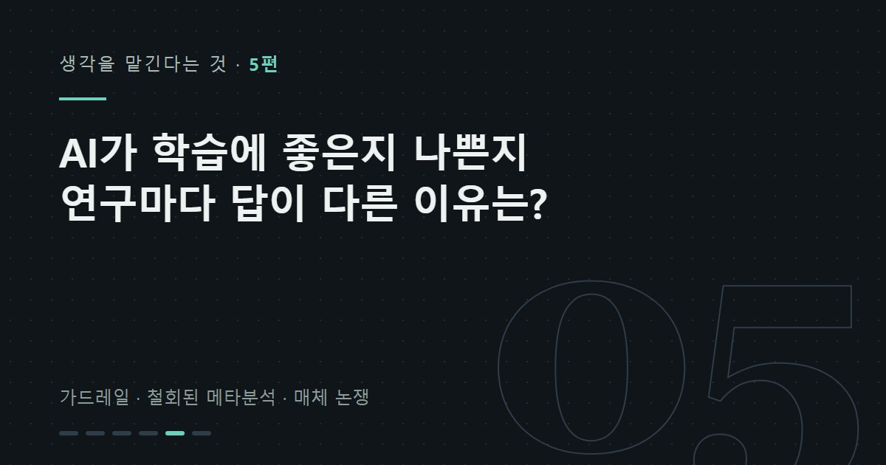

**생각을 맡긴다는 것 시리즈** · [1 맡김의 득실](/post/outsourcing-mind-01-offloading-tradeoffs/) · [2 앎의 착각](/post/outsourcing-mind-02-illusion-of-knowing/) · [3 읽기와 믿기](/post/outsourcing-mind-03-reading-and-trust/) · [4 대답하는 AI](/post/outsourcing-mind-04-answering-ai/) · **5 엇갈리는 증거** · [6 다시 내 것으로](/post/outsourcing-mind-06-reclaiming-thought/)

"ChatGPT, 학습 효과 크다" "AI 쓰면 뇌가 게을러진다." 같은 주에 정반대 제목의 기사가 나오는 일이 흔하다. 어느 쪽이 맞을까? 이번 편의 답은 조금 김빠지게 들릴 수 있다. **둘 다 맞을 수 있고, 둘 다 생각보다 약할 수 있다.** 그 이유를 연구들로 하나씩 풀어 본다.

<figure>
  
  <figcaption>시리즈 5편. 엇갈리는 증거를 읽는 법</figcaption>
</figure>

## 연구 1. 쓰는 동안 48% 오르고, 빼앗자 17% 떨어졌다

*Bastani, H., Bastani, O., Sungu, A., Ge, H., Kabakcı, Ö., & Mariman, R. (2025). Generative AI without guardrails can harm learning: Evidence from high school mathematics. PNAS, 122(26), e2422633122.*

튀르키예의 한 고등학교에서 약 1,000명의 학생을 대상으로 현장 실험을 했다. 학생들은 수학 연습 시간에 세 조건 중 하나로 공부했다. 아무 도구 없이, 일반 ChatGPT와 비슷한 'GPT Base'로, 또는 교사가 설계해 답 대신 힌트를 주도록 만든 'GPT Tutor'로.

- 연습하는 동안에는 성적이 GPT Base에서 48%, GPT Tutor에서 127% 올랐다.
- 그런데 AI 없이 본 시험에서 GPT Base 집단은 **한 번도 AI를 쓰지 않은 집단보다 17% 낮은** 점수를 받았다.
- GPT Tutor 집단에서는 이런 손해가 대부분 사라졌다.

**쉽게 말하면** 같은 GPT-4라도 '답을 주는 AI'는 목발이 되었고, '힌트를 주는 AI'는 비계가 되었다. 그리고 그 차이는 AI를 **치웠을 때** 비로소 드러났다.

## 연구 2. 대신하면 넓고 얕게, 보완하면 깊게

*Lehmann, M., Cornelius, P. B., & Sting, F. J. (2024). AI meets the classroom: When do large language models harm learning? arXiv:2409.09047.*

사전 등록한 두 개의 실험실 실험에서 LLM은 전체 학습 성과에 아무 효과도 내지 않았다. 평균만 보면 "효과 없음"이다. 하지만 사용 방식을 나누어 보자 그림이 달라졌다.

- 연습문제 풀이를 생성하게 하는 등 학습 활동을 LLM으로 **대신한** 학생은 더 많은 주제를 다룰 수 있었지만, 각 주제의 이해는 얕아졌다.
- 설명을 요청하는 등 학습 활동을 LLM으로 **보완한** 학생은 이해의 손실 없이 도움을 받았다.

**쉽게 말하면** 평균 효과가 0이라는 것은 효과가 없다는 뜻이 아니라, 좋아진 사람과 나빠진 사람이 서로 상쇄되었다는 뜻일 수 있다.

## 연구 3. 결과물은 좋아졌지만 배움은 그대로였다

*Fan, Y., Tang, L., Le, H., et al. (2025). Beware of metacognitive laziness: Effects of generative artificial intelligence on learning motivation, processes, and performance. British Journal of Educational Technology, 56(2), 489-530.*

대학생 117명이 글쓰기 과제를 하며 ChatGPT, 인간 전문가, 체크리스트 도구 등 서로 다른 지원을 받았다. ChatGPT 집단은 **에세이 점수가 가장 많이 올랐지만**, 지식 획득과 전이에서는 다른 집단과 차이가 없었다. 학습 과정 기록을 보면, 이들은 스스로 계획하고 점검하고 평가하는 활동을 AI에 넘기는 경향을 보였다. 연구진은 이를 **메타인지적 게으름**이라고 불렀다.

**쉽게 말하면** "결과물이 좋아졌다"와 "배웠다"는 다른 말이다. 많은 연구가 앞의 것만 잰다.

## 연구 4. 가장 큰 효과를 보고한 메타분석은 철회되었다

*Wang, J., & Fan, W. (2025). The effect of ChatGPT on students' learning performance, learning perception, and higher-order thinking: Insights from a meta-analysis. Humanities and Social Sciences Communications, 12, 621. (2026년 철회)*

51편의 연구를 종합해 ChatGPT가 학습 성과에 **큰 효과(g = 0.867)**를 낸다고 보고한 이 메타분석은 널리 인용되었다. 하지만 2026년 4월, 학술지는 메타분석 안의 불일치 문제를 이유로 논문을 철회했다.

반면 비판적 사고에 대한 2026년의 3수준 메타분석(Sun 외, 26편 연구, 47개 효과 크기)은 평균 효과가 g = 0.544로 긍정적이었지만, **예측 구간이 -0.588에서 1.677까지** 걸쳐 있었다. 다음에 새로 하는 연구에서는 효과가 크게 긍정적일 수도, 오히려 부정적일 수도 있다는 뜻이다.

반대편도 사정은 비슷하다. "AI가 뇌를 게으르게 만든다"는 MIT의 뇌파 연구는 동료 심사 전 프리프린트였고, 마지막 세션까지 마친 참가자는 18명이었다([몸이 아는 것, AI가 아는 것 3편](/post/body-and-ai-03-tools-and-offloading/) 참고).

**쉽게 말하면** 양쪽의 간판 연구가 모두 생각보다 단단하지 않다. 평균 하나로 결론 내리기 어려운 분야다.

## 연구 5. 40년 된 논쟁, 매체가 학습을 바꾸는가

*Clark, R. E. (1983). Reconsidering research on learning from media. Review of Educational Research, 53(4), 445-459. / Kozma, R. B. (1994). Will media influence learning? Reframing the debate. Educational Technology Research and Development, 42(2), 7-19.*

교육공학에는 유명한 논쟁이 있다. Clark은 매체가 학습에 영향을 주지 않는다고 주장했다. 매체는 식료품을 실어 나르는 트럭일 뿐이고, 영양을 바꾸는 것은 트럭이 아니라 그 안의 음식, 곧 **교수 방법**이라는 것이다. 이에 Kozma는 반박했다. 학습자가 스스로 하지 못하거나 하지 않는 인지 작업을 매체가 대신 보여 주고 수행할 수 있다면, 매체의 능력과 방법은 떼어 놓을 수 없다는 것이다.

**쉽게 말하면** Clark은 "무엇으로 가르치느냐보다 어떻게 가르치느냐"를, Kozma는 "어떤 도구는 가르치는 방식 자체를 바꾼다"를 말했다.

## 정리. 엇갈리는 증거를 읽는 네 가지 질문

| 질문 | 왜 중요한가 | 해당 연구 |
|---|---|---|
| AI를 뺀 뒤에도 쟀는가? | 도움받은 수행과 남은 능력은 다르다 | Bastani 외 |
| 결과물을 쟀나, 배움을 쟀나? | 에세이 점수와 지식 전이는 다르다 | Fan 외 |
| 어떻게 썼는가? | 대체와 보완은 정반대 결과를 낸다 | Lehmann 외 |
| 증거는 얼마나 단단한가? | 철회, 작은 표본, 넓은 예측 구간 | Wang & Fan, Sun 외, MIT |

## 날카롭게 보기

**"매체가 아니라 활동이 중요하다"와 "AI는 패러다임 전환이다"는 동시에 참일 수 없다.** AI 교육 담론은 종종 이 두 문장을 함께 쓴다. 앞의 문장은 Clark의 입장이고, 뒤의 문장은 Kozma의 입장이다. 생성형 AI에 관해서라면 증거는 Kozma 쪽을 가리킨다. 같은 GPT-4가 '답을 주는 설정'에서는 학습을 해치고 '힌트를 주는 설정'에서는 지켜 냈다. 매체의 **설계** 자체가 학생이 어떤 인지 활동을 하게 될지를 결정한 것이다. 그러니 더 정확한 문장은 이렇다. **매체가 중립적인 것이 아니라, 매체의 설계가 활동을 결정한다.**

그리고 이 분야에서 지금 가장 단단하게 말할 수 있는 결론은 하나다. **AI가 학습에 좋은지 나쁜지가 아니라, 설계와 사용 방식에 따라 효과의 부호가 바뀐다.** 이 결론은 화려한 헤드라인을 만들지 못한다. 하지만 교사에게는 가장 쓸모 있다. "써도 되는가?"를 고민하는 대신 "어떻게 설계해야 플러스가 되는가?"를 물을 수 있기 때문이다.

마지막으로, 연구를 읽는 사람에게 남는 교훈도 있다. 이 시리즈 2편의 주제였던 '앎의 착각'은 연구 소비자에게도 일어난다. 메타분석이라는 권위, 『네이처』라는 이름, 뇌 사진이라는 시각적 증거는 우리의 인식적 경계를 쉽게 무장 해제시킨다. AI의 답을 의심하라고 가르치는 만큼, **AI에 관한 연구도 같은 눈으로** 읽어야 한다.

## 더 생각해 볼 질문

1. 최근 본 'AI와 학습' 기사 하나를 골라 위의 네 가지 질문을 던져 보자. 몇 개에 답할 수 있는가?
2. 우리 학교나 수업에서 'GPT Tutor'처럼 답 대신 힌트를 주는 설정을 만든다면 어떤 규칙이 필요할까?
3. 평균 효과가 0일 때, 그 안에 숨어 있는 '좋아진 학생'과 '나빠진 학생'을 어떻게 찾아낼 수 있을까?

마지막 편에서는 이 시리즈의 질문을 한 걸음 더 밀고 나간다. 맡긴 생각을 어떻게 다시 내 것으로 만들 수 있을까?

## 참고 자료

- Bastani, H., Bastani, O., Sungu, A., Ge, H., Kabakcı, Ö., & Mariman, R. (2025). Generative AI without guardrails can harm learning: Evidence from high school mathematics. *Proceedings of the National Academy of Sciences, 122*(26), e2422633122. [doi.org/10.1073/pnas.2422633122](https://doi.org/10.1073/pnas.2422633122)
- Lehmann, M., Cornelius, P. B., & Sting, F. J. (2024). AI meets the classroom: When do large language models harm learning? *arXiv:2409.09047*. [arxiv.org/abs/2409.09047](https://arxiv.org/abs/2409.09047)
- Fan, Y., Tang, L., Le, H., Shen, K., Tan, S., Zhao, Y., Shen, Y., Li, X., & Gašević, D. (2025). Beware of metacognitive laziness: Effects of generative artificial intelligence on learning motivation, processes, and performance. *British Journal of Educational Technology, 56*(2), 489-530. [doi.org/10.1111/bjet.13544](https://doi.org/10.1111/bjet.13544)
- Wang, J., & Fan, W. (2025). The effect of ChatGPT on students' learning performance, learning perception, and higher-order thinking: Insights from a meta-analysis. *Humanities and Social Sciences Communications, 12*, 621. 2026년 철회. [doi.org/10.1057/s41599-025-04787-y](https://doi.org/10.1057/s41599-025-04787-y)
- Sun, X., Liu, C., Li, P., & Cai, Z. (2026). Effects of generative AI tools on students' critical thinking: A three-level meta-analysis. *Educational Psychology Review, 38*, 84. [doi.org/10.1007/s10648-026-10180-1](https://doi.org/10.1007/s10648-026-10180-1)
- Kosmyna, N., et al. (2025). Your brain on ChatGPT: Accumulation of cognitive debt when using an AI assistant for essay writing task. *arXiv:2506.08872*. [arxiv.org/abs/2506.08872](https://arxiv.org/abs/2506.08872)
- Clark, R. E. (1983). Reconsidering research on learning from media. *Review of Educational Research, 53*(4), 445-459. [doi.org/10.3102/00346543053004445](https://doi.org/10.3102/00346543053004445)
- Clark, R. E. (1994). Media will never influence learning. *Educational Technology Research and Development, 42*(2), 21-29. [doi.org/10.1007/BF02299088](https://doi.org/10.1007/BF02299088)
- Kozma, R. B. (1994). Will media influence learning? Reframing the debate. *Educational Technology Research and Development, 42*(2), 7-19. [doi.org/10.1007/BF02299087](https://doi.org/10.1007/BF02299087)
- 함께 읽기: [AI 챗봇 사용, 학생들의 사고력을 덜어내는가 변화시키는가?](/post/cognitive-offloading-in-the-age-of-ai/)
