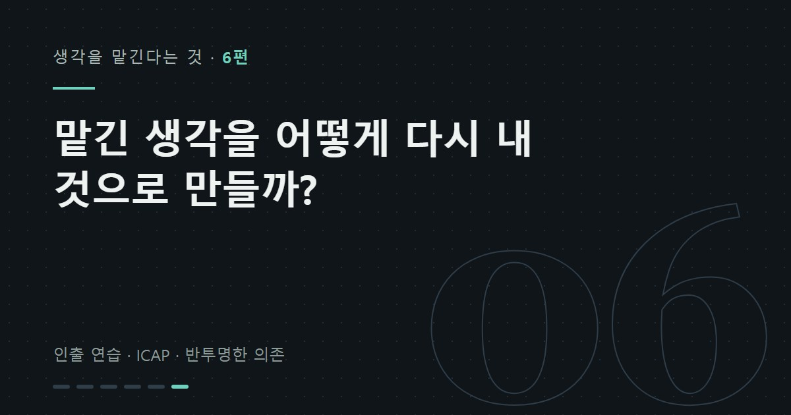

**생각을 맡긴다는 것 시리즈** · [1 맡김의 득실](/post/outsourcing-mind-01-offloading-tradeoffs/) · [2 앎의 착각](/post/outsourcing-mind-02-illusion-of-knowing/) · [3 읽기와 믿기](/post/outsourcing-mind-03-reading-and-trust/) · [4 대답하는 AI](/post/outsourcing-mind-04-answering-ai/) · [5 엇갈리는 증거](/post/outsourcing-mind-05-mixed-evidence/) · **6 다시 내 것으로**

지금까지의 이야기를 한 문장으로 줄이면 이렇다. 사람은 늘 생각을 맡겨 왔고(1편), 맡긴 것을 내 것으로 착각하기 쉬우며(2편), 그렇다고 믿고 맡기는 것 자체가 어리석은 것은 아니고(3편), 대답하는 AI는 그 맡김의 범위를 대화와 추론으로 넓혔으며(4편), 그 효과는 설계에 따라 부호가 바뀐다(5편).

그렇다면 남는 질문은 "맡겨도 되는가?"가 아니다. **"맡긴 것을 어떻게 다시 내 것으로 회수하는가?"**다. 마지막 편은 이 질문에 답을 주는 연구들을 모았다.

<figure>
  
  <figcaption>시리즈 6편. 맡긴 생각을 다시 내 것으로</figcaption>
</figure>

## 연구 1. 다시 읽기보다 떠올리기

*Roediger, H. L., & Karpicke, J. D. (2006). Test-enhanced learning: Taking memory tests improves long-term retention. Psychological Science, 17(3), 249-255.*

대학생들이 짧은 글을 공부한 뒤 한 집단은 그 글을 다시 읽었고, 다른 집단은 글을 덮고 기억나는 것을 적었다. 5분 뒤 시험에서는 다시 읽은 집단이 더 잘했다. 그런데 2일 뒤, 1주일 뒤에는 결과가 뒤집혀 **떠올리기를 한 집단**이 훨씬 더 많이 기억했다.

이것이 Bjork 부부가 말한 **바람직한 어려움**의 대표적인 예다. 당장은 더 힘들고 성과도 낮아 보이지만, 그 어려움이 장기 기억을 만든다.

**쉽게 말하면** AI가 정리해 준 내용을 다시 읽는 것은 편하지만 남지 않는다. 화면을 덮고 내 말로 다시 떠올려 볼 때 비로소 내 것이 된다.

## 연구 2. 먼저 헤매고, 그다음에 배운다

*Sinha, T., & Kapur, M. (2021). When problem solving followed by instruction works: Evidence for productive failure. Review of Educational Research, 91(5), 761-798.*

새 개념을 배울 때 설명을 먼저 듣고 문제를 푸는 것이 나을까, 문제를 먼저 붙잡고 헤맨 뒤 설명을 듣는 것이 나을까? 53편의 연구, 166개의 비교를 종합한 결과, **먼저 문제를 풀어 본 쪽**이 중간 정도로 더 효과적이었다(g = 0.36). '생산적 실패'의 원리를 충실히 따른 경우에는 효과가 더 컸다.

**주의할 점** 초등 2~5학년처럼 어린 학습자와 영역 일반 기술에서는 반대로 설명을 먼저 듣는 쪽이 유리한 경향이 있었다. 어려움이 '바람직한지'는 학습자에 따라 다르다.

**쉽게 말하면** AI를 쓰는 순서가 중요하다. 먼저 혼자 씨름하고, AI의 설명은 그다음에. 단, 기초가 아직 없는 학습자에게는 먼저 길을 보여 주는 편이 낫다.

## 연구 3. '했다'와 '생각했다'를 구분하는 틀, ICAP

*Chi, M. T. H., & Wylie, R. (2014). The ICAP framework: Linking cognitive engagement to active learning outcomes. Educational Psychologist, 49(4), 219-243.*

Chi와 Wylie는 학습자의 참여를 네 단계로 나눈다.

- **수동(Passive)**: 설명을 듣거나 읽는다.
- **능동(Active)**: 밑줄을 긋거나 따라 적는 등 몸을 움직인다.
- **구성(Constructive)**: 자료에 없는 새로운 설명, 예시, 질문을 만들어 낸다.
- **상호작용(Interactive)**: 상대와 함께 서로의 생각을 발전시킨다.

뒤로 갈수록 학습 효과가 커진다. 중요한 기준은 **산출물에 자료 너머의 아이디어가 있는가**다. 겉으로 활발해 보여도 새로운 생각이 없으면 '능동'에 머문다.

**쉽게 말하면** AI와 오래 대화했다고 '상호작용'이 아니다. 대화 기록 속에 AI가 준 적 없는 학생의 아이디어가 있어야 한다.

## 연구 4. 답 대신 질문하는 AI

*Xi, L., Zhang, Y., & Wang, Q. (2026). Investigating the effects of an LLM-based Socratic conversational agent on students' academic performance and reflective thinking in higher education. Computers & Education, 241, 105494.*

중국 대학생 94명을 무작위로 나누어, 한쪽은 소크라테스식 질문 전략을 넣은 AI 대화 에이전트를, 다른 쪽은 일반 AI 에이전트를 쓰게 했다. 질문하는 AI를 쓴 집단이 **학업 성취와 반성적 사고 모두에서** 앞섰고, 특히 '비판적 성찰' 차원에서 차이가 컸다. 학생들은 AI가 계속 되묻는 바람에 자기 실험 설계의 문제를 스스로 찾게 되었다고 말했다.

비슷하게 Yang 외(2026)는 Java 프로그래밍 수업에서 정답을 바로 주는 AI 지원(57명)과 소크라테스식 지원(48명)을 비교했는데, 소크라테스식 지원을 받은 학생들이 스스로 보고한 **인식적 게으름**이 더 낮았다.

**주의할 점** 둘 다 한 학기 이내의 비교적 작은 연구이고, 후자는 무작위 배정이 아닌 두 학급 비교다. 방향은 일관되지만 아직 초기 증거다.

## 연구 5. 불투명한 의존과 반투명한 의존

*Wagenknecht, S. (2014). Opaque and translucent epistemic dependence in collaborative scientific practice. Episteme, 11(4), 475-492.*

과학철학자 Wagenknecht는 공동 연구를 하는 과학자들을 관찰하고 의존을 두 가지로 나누었다.

- **불투명한 의존**: 동료의 작업을 내가 직접 해내거나 깊이 평가할 전문성이 없는 상태에서 기대는 것.
- **반투명한 의존**: 그 전문성을 갖고 있어서, 맡기되 필요하면 들여다보고 따질 수 있는 상태에서 기대는 것.

둘 다 '맡긴다'는 점에서는 같다. 다른 것은 맡긴 것을 **들여다볼 수 있느냐**다.

## 정리. '내 판단'이라고 말할 수 있는 네 가지 조건

학습분석 연구자 Yan, Greiff, Lodge, Gašević(2025)은 생성형 AI가 끌어올리는 '수행의 향상'과 깊은 인지·메타인지 처리가 필요한 '학습'을 분명히 구분해야 한다고 강조했다. 이 구분을 수업에서 쓸 수 있도록, 앞의 연구들을 모아 맡긴 생각을 내 것으로 회수했는지 확인하는 네 가지 질문으로 정리해 보았다.

| 조건 | 확인 질문 | 수업에서의 예 | 근거 연구 |
|---|---|---|---|
| 회수 | AI를 끄고도 다시 만들 수 있는가? | AI 없이 보는 짧은 확인 과제 | Bastani 외(5편), Roediger & Karpicke |
| 방어 | 반론에 스스로 답할 수 있는가? | 친구나 교사의 반론에 답하는 구술 | Xi 외, Yang 외 |
| 보정 | 내 확신이 실제 정확도와 맞는가? | 답마다 확신도 적기 | Fernandes 외(2편) |
| 구성 | AI가 주지 않은 내 생각이 있는가? | 대화 기록에서 내 아이디어 표시하기 | Chi & Wylie |

## 날카롭게 보기

**AI 시대 교육의 목표는 외주화를 막는 것이 아니라, 불투명한 의존을 반투명한 의존으로 바꾸는 것이다.** 우리는 앞으로도 AI에 많은 것을 맡길 것이다. 그것을 막으려는 교육은 문자 이전으로 돌아가자는 말만큼 힘이 없다. 하지만 들여다볼 수 없는 채로 맡기는 것과, 들여다볼 수 있는 채로 맡기는 것은 전혀 다르다. 앞의 것은 맡긴 것을 잃는 일이고, 뒤의 것은 맡긴 것을 거느리는 일이다.

여기서 흔한 오해 하나를 짚어야 한다. AI 시대의 교육을 말할 때 "암기 위주 교육은 끝났다"는 말이 자주 따라온다. 그러나 '바람직한 어려움'의 대표 기법인 인출 연습은 결국 **제대로 된 암기**다. 그리고 3편에서 보았듯 머릿속 지식이 없으면 비판도, 반투명한 의존도 불가능하다. AI의 답을 들여다보는 눈은 바로 그 지식으로 만들어진다. 그러니 버려야 할 것은 암기가 아니라 **인출과 전이 없는 재현**이다. 외운 것을 그대로 되풀이하는 공부는 버리되, 외운 것을 떠올리고 새 상황에 적용하는 공부는 오히려 더 강화해야 한다.

마지막으로, 위의 네 조건은 '내 판단'이라는 철학적 질문을 **평가 설계의 언어**로 바꾸어 준다. "AI를 썼는가?"를 묻는 평가는 감시가 될 뿐이다. "AI를 쓴 뒤 무엇을 회수했는가?"를 묻는 평가는 배움이 된다. 결과물이 아니라 **회수된 것**을 보는 평가, 이것이 이 시리즈가 도착한 자리다.

## 더 생각해 볼 질문

1. 다음 과제 하나에 네 가지 조건 중 하나만 넣는다면 무엇을 넣겠는가? 그 이유는?
2. 내가 AI에 기대는 일 가운데 '반투명한 의존'인 것과 '불투명한 의존'인 것을 나누어 보자. 불투명한 것 하나를 반투명하게 바꾸려면 무엇을 배워야 할까?
3. 학생이 AI와 나눈 대화 기록을 제출하게 한다면, 그 기록에서 무엇을 보아야 할까?

## 참고 자료

- Roediger, H. L., & Karpicke, J. D. (2006). Test-enhanced learning: Taking memory tests improves long-term retention. *Psychological Science, 17*(3), 249-255. [doi.org/10.1111/j.1467-9280.2006.01693.x](https://doi.org/10.1111/j.1467-9280.2006.01693.x)
- Bjork, E. L., & Bjork, R. A. (2011). Making things hard on yourself, but in a good way: Creating desirable difficulties to enhance learning. In M. A. Gernsbacher et al. (Eds.), *Psychology and the real world* (pp. 56-64). Worth.
- Sinha, T., & Kapur, M. (2021). When problem solving followed by instruction works: Evidence for productive failure. *Review of Educational Research, 91*(5), 761-798. [doi.org/10.3102/00346543211019105](https://doi.org/10.3102/00346543211019105)
- Chi, M. T. H., & Wylie, R. (2014). The ICAP framework: Linking cognitive engagement to active learning outcomes. *Educational Psychologist, 49*(4), 219-243. [doi.org/10.1080/00461520.2014.965823](https://doi.org/10.1080/00461520.2014.965823)
- Xi, L., Zhang, Y., & Wang, Q. (2026). Investigating the effects of an LLM-based Socratic conversational agent on students' academic performance and reflective thinking in higher education. *Computers & Education, 241*, 105494. [doi.org/10.1016/j.compedu.2025.105494](https://doi.org/10.1016/j.compedu.2025.105494)
- Yang, H., Xu, N., Shao, Y., Yang, H., & Zhang, W. (2026). Direct-answer versus Socratic generative AI support in programming learning. *International Journal of Human-Computer Interaction*. [doi.org/10.1080/10447318.2026.2739744](https://doi.org/10.1080/10447318.2026.2739744)
- Wagenknecht, S. (2014). Opaque and translucent epistemic dependence in collaborative scientific practice. *Episteme, 11*(4), 475-492. [doi.org/10.1017/epi.2014.25](https://doi.org/10.1017/epi.2014.25)
- Yan, L., Greiff, S., Lodge, J. M., & Gašević, D. (2025). Distinguishing performance gains from learning when using generative AI. *Nature Reviews Psychology, 4*(7), 435-436. [doi.org/10.1038/s44159-025-00467-5](https://doi.org/10.1038/s44159-025-00467-5)
- 함께 읽기: [AI가 다 알려 주는 시대에 왜 여전히 머릿속 지식이 필요한가?](/post/oakley-2026-memory-paradox/) · [AI가 답을 주는 교실, 학생용 워크시트는 무엇을 담아야 할까?](/post/student-worksheet-when-ai-answers/)
